# PokéField 검증 결과

기준일은 2026-10-23입니다. 요구사항 정의서 4장·6장과 공식 셀프 점검 27항목을 기준으로 기존 실행 결과를 정리합니다. 선행 증빙 편집은 기존 자료만 재사용했으며, 최신 재점검에서는 아래 격리 회귀와 실제 브라우저 검사를 새로 실행했습니다. **선행 8개 테스트·Cloud 22건 화면은 과거 이력입니다. 최신 검사와 셀프 판정은 맨 앞 최신 재점검 절 및 아래 최신 공식 셀프 절을 우선합니다.**


## 이번 증빙 내장 보완 — 2026-10-23

현재 소스·테스트·색인 관련 102개 파일이 직전 163/163 회귀 실행 시점과 일치함을 확인해 전체 테스트는 중복 실행하지 않았습니다. [동일성 확인](evidence/logs/embedded-evidence-source-check.json)입니다. 이번에는 실제 기존 함수를 호출하는 격리 Streamlit QA 화면 2개만 추가 촬영했습니다. 운영 UI나 실제 GMS 답변의 증거로 사용하지 않습니다. 네트워크 전송을 차단하고 복사 색인을 읽었으며 유료 API 호출은 0회입니다.

### 4.1·4.3: 현재 데이터와 LangGraph 실제 로드

기존 Catalog 및 복사 Chroma의 건수와 실제 그래프 구성을 확인했습니다. 생성 노드는 실행하지 않았습니다.

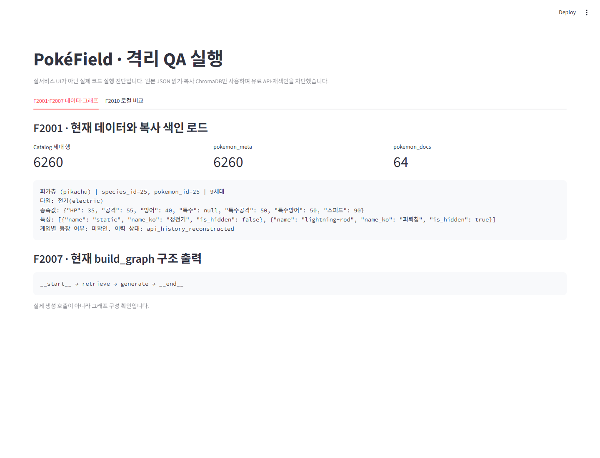

*F2001·F2007 · 조건: 현재 Catalog·복사 Chroma 읽기, 실제 build_graph 구성. 결과: 6,260행=meta6,260·docs64, retrieve→generate 확인 / 생성 호출 없음. 환경: 실제 격리 QA 진단 / 실서비스 UI 아님. 일자: 2026-10-23 이번 실제 촬영. 증빙!B50.*


### 4.4: F2010 로컬 세대 비교 실제 실행

기존 비교 UI 함수를 API 키 없이 실행했습니다. 팬텀 6→7의 특성 변경은 로컬 비교 증거이며 실제 GMS 비교 답변 증거는 여전히 부족합니다.

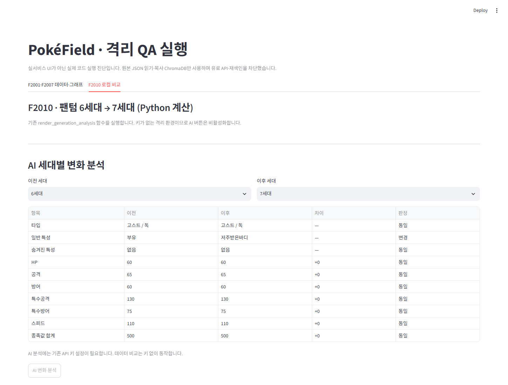

*F2010 · 조건: 기존 비교 UI 함수, 팬텀 6→7·API 키 없음. 결과: 부유→저주받은바디, 타입·종족값 동일 / AI 버튼 비활성·LLM 없음. 환경: 실제 격리 QA / 로컬 Python / 실서비스 UI 아님. 일자: 2026-10-23 이번 실제 촬영. 증빙!B83.*

[격리 실행 결과](evidence/logs/isolated-evidence-execution.json) · [브라우저 촬영 결과](evidence/logs/embedded-capture-results.json) · [XLSX 양식·이미지 보존 검사](evidence/logs/embedded-xlsx-preservation.json)입니다.

### XLSX 이미지 번호와 원본 목록

기존 앱 캡처 24개, 기존 로그 시각화 1개, 신규 격리 QA 화면 2개를 내장했습니다. 로그 이미지는 실제 앱 화면으로 세지 않습니다. 원본 시트 2개와 상호 평가 정보는 보존했습니다. 판정은 통과 16·실패 2·미확인 3·해당없음 6으로 유지합니다. 기존 아래 XLSX 미리보기는 내장 시트 추가 전 기록입니다. 최신 H열은 본 목록과 실제 XLSX를 기준으로 확인합니다.

| 이미지 | 요구사항·유형 | XLSX 위치 | 원본 |
|---|---|---|---|
| IMG-01 | F2001·F2007 · 실제 격리 QA 진단 / 실서비스 UI 아님 | 증빙!B50 | [isolated-data-graph.png](evidence/screenshots/isolated-data-graph.png) |
| IMG-02 | F2010 · 실제 격리 QA / 로컬 Python / 실서비스 UI 아님 | 증빙!B83 | [isolated-gengar-local-compare.png](evidence/screenshots/isolated-gengar-local-compare.png) |
| IMG-03 | F2001~F2007·NF2002 · 기존 로그 시각화 / 앱 캡처 아님 | 증빙!B116 | [08-실제실행로그시각화-UI아님.png](evidence/screenshots/08-실제실행로그시각화-UI아님.png) |
| IMG-04 | F2008 · 기존 로컬 Chrome / FakeLLM UI | 증빙!B211 | [04-citations-FakeLLM-current.png](evidence/screenshots/04-citations-FakeLLM-current.png) |
| IMG-05 | F2006·F2008 · 기존 로컬 Chrome / FakeLLM UI | 증빙!B244 | [04b-external-citations-FakeLLM-current.png](evidence/screenshots/04b-external-citations-FakeLLM-current.png) |
| IMG-06 | F2007·F2008 · 기존 로컬 Chrome / FakeLLM UI | 증빙!B277 | [07-no-evidence-FakeLLM-current.png](evidence/screenshots/07-no-evidence-FakeLLM-current.png) |
| IMG-07 | F2009 · 기존 로컬 Chrome 모바일 크기 / 로컬 타입 답변 | 증빙!B310 | [game-mobile-chat.png](evidence/screenshots/game-mobile-chat.png) |
| IMG-08 | F2011 · 기존 로컬 Chrome / 로컬 답변 | 증빙!B343 | [ability-chat.png](evidence/screenshots/ability-chat.png) |
| IMG-09 | F2011 · 기존 로컬 Chrome / 로컬 답변 | 증빙!B376 | [moves-chat.png](evidence/screenshots/moves-chat.png) |
| IMG-10 | F2012 · 기존 로컬 Chrome / FakeLLM UI | 증빙!B409 | [03-progress-FakeLLM-current.png](evidence/screenshots/03-progress-FakeLLM-current.png) |
| IMG-11 | F2012·NF2004 · 기존 격리 로컬 Chrome | 증빙!B442 | [06-missing-key-current.png](evidence/screenshots/06-missing-key-current.png) |
| IMG-12 | F2012·NF2004 · 기존 격리 로컬 Chrome | 증빙!B475 | [06-empty-index-current.png](evidence/screenshots/06-empty-index-current.png) |
| IMG-13 | 부가 포획·도감 / F2009 선택 UI 참고 · 선행 실제 로컬 Component v2 / API 차단 | 증빙!B508 | [latest-browser-A-dex.png](evidence/screenshots/latest-browser-A-dex.png) |
| IMG-14 | 부가 포획→도감 · 선행 실제 로컬 Component v2 / API 차단 | 증빙!B541 | [latest-browser-A-field-dex.png](evidence/screenshots/latest-browser-A-field-dex.png) |
| IMG-15 | 부가 포획 저장 오류 / F2012 UI 참고 · 선행 실제 로컬 Chrome / 저장소 차단 | 증빙!B574 | [latest-browser-storage-blocked.png](evidence/screenshots/latest-browser-storage-blocked.png) |
| IMG-16 | 배포·개인 저장 관찰 · 선행 실제 Cloud / 읽기 전용 / LLM 없음 | 증빙!B607 | [latest-cloud-A.png](evidence/screenshots/latest-cloud-A.png) |
| IMG-17 | 배포·개인 저장 관찰 · 선행 실제 Cloud / 읽기 전용 / LLM 없음 | 증빙!B640 | [latest-cloud-B.png](evidence/screenshots/latest-cloud-B.png) |
| IMG-18 | 부가 필드 UI · 기존 실제 로컬 Chrome | 증빙!B673 | [01-field-desktop-current.png](evidence/screenshots/01-field-desktop-current.png) |
| IMG-19 | 부가 도감 / F2009 선택 UI 참고 · 기존 실제 로컬 Chrome | 증빙!B706 | [02-dex-current.png](evidence/screenshots/02-dex-current.png) |
| IMG-20 | F2008·F2012 · 기존 로컬 Chrome 모바일 크기 / FakeLLM | 증빙!B739 | [05-mobile-FakeLLM-current.png](evidence/screenshots/05-mobile-FakeLLM-current.png) |
| IMG-21 | 부가 포획 · 기존 실제 로컬 JS / 격리 SQLite | 증빙!B772 | [capture.png](evidence/screenshots/capture.png) |
| IMG-22 | 부가 포획→도감 · 기존 실제 로컬 JS / 격리 SQLite | 증빙!B805 | [captured-dex.png](evidence/screenshots/captured-dex.png) |
| IMG-23 | 부가 개인 저장·도감 · 선행 실제 로컬 Chrome / localStorage | 증빙!B838 | [browser-A-dex.png](evidence/screenshots/browser-A-dex.png) |
| IMG-24 | 부가 포획→도감 · 선행 실제 로컬 Chrome / localStorage | 증빙!B871 | [browser-A-field-dex.png](evidence/screenshots/browser-A-field-dex.png) |
| IMG-25 | 부가 저장 오류 · 선행 실제 로컬 Chrome / 저장소 차단 | 증빙!B904 | [browser-storage-blocked.png](evidence/screenshots/browser-storage-blocked.png) |
| IMG-26 | 배포 과거 관찰 · 과거 실제 Cloud / 읽기 전용 | 증빙!B937 | [cloud-A.png](evidence/screenshots/cloud-A.png) |
| IMG-27 | 배포 과거 관찰 · 과거 실제 Cloud / 읽기 전용 | 증빙!B970 | [cloud-B.png](evidence/screenshots/cloud-B.png) |

<a id="latest-selfcheck"></a>

## 최신 재점검 결과 (2026-10-23)

이번 재점검은 현재 코드·공식 27항목·기존 증빙을 다시 대조하고 격리 회귀·실제 로컬 Chrome A/B·Cloud 읽기 검사를 실행한 결과입니다. 과거 GMS·155개 회귀·선행 163개 결과는 아래 실행 이력으로 보존합니다. 이번 **유료 LLM·임베딩·재색인 호출은 0회**입니다.

| 최신 검사 | 실제 결과·환경 | 원본 증빙 |
|---|---|---|
| 전체 회귀 | 163/163 통과, 49.702초, 실패/오류/건너뜀 0입니다. 격리 저장소·FakeLLM/FakeEmbeddings·모의 HTTP이며 미모의 requests 전송을 차단했습니다. | [집계](evidence/logs/latest-unit-summary-20261023.json) · [전체 로그](evidence/logs/latest-unit-tests-20261023.log) |
| 데이터·색인 로드 | 현재 Catalog 6,260행, 복사 Chroma meta 6,260·docs 64를 확인했습니다. 원본 색인에 쓰지 않았고 새 임베딩·재색인을 하지 않았습니다. | [현재 로드·그래프](evidence/logs/latest-backend-security-results.json) |
| 브라우저 개인 포획 | 실제 로컬 Component v2·독립 A/B 포획·각 새로고침·새 탭 복원·도감·같은 프로필 탭 동기화·차단 안내 통과입니다. 콘솔 예외·유료 요청 0입니다. | [최신 A/B 결과](evidence/logs/latest-browser-browser-results.json) |
| 저장 예외·중복 | 생산 JS+실제 localStorage, 서버 ACK만 모의입니다. 중복 횟수·동일 이벤트 멱등·과거 SQLite 이벤트 이관 방지·용량 초과·손상 보존을 확인했습니다. | [별도 모의 ACK 결과](evidence/logs/latest-storage-edge-results.json) |
| 실제 Cloud 읽기 | 새 A/B 모두 최초/새로고침 0 / 1025, 개인 키 0개·pageerror 0입니다. 이전 22건 화면과 다른 최신 관찰입니다. 포획·채팅·운영 색인 검사는 실행하지 않았습니다. | [Cloud 최신 로그](evidence/logs/latest-cloud-readonly-results.json) |
| 키·내부 정보 | 현재 소스·문서·증빙 텍스트 102개에서 실제 설정 키의 정확 일치 0입니다. UI 비노출 AppTest도 최신 회귀에 포함됩니다. 최종 제출 패키지 전체 검사는 별도입니다. | [보안 범위](evidence/logs/latest-backend-security-results.json) |

### 최신 로컬·Cloud 화면

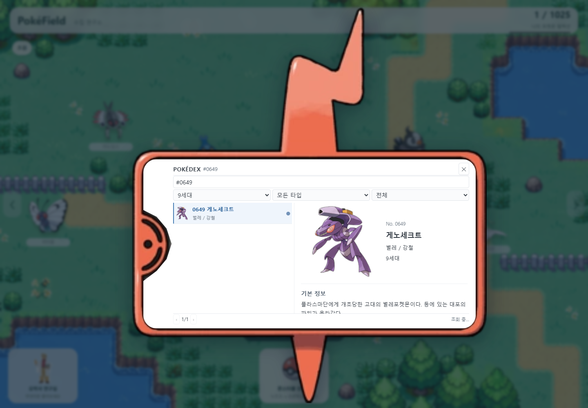

*IMG-13 · 부가 포획·도감 / F2009 선택 UI 참고 · 선행 실제 로컬 Component v2 / API 차단. 조건: 독립 A 포획 후 새로고침·도감 상세. 결과: 개인 수집 수·포획 횟수 복원 / Cloud 증거 아님. 일자: 2026-10-23 점검 기록(기존 캡처의 정확한 촬영 시각은 미기록). XLSX: 증빙!B508. 기존 범위 설명: 2026-10-23 실제 로컬 Chrome·API 차단 격리 앱입니다. 수집 수와 도감의 개인 포획 횟수를 확인했습니다. 실제 GMS 화면이 아닙니다.*


*IMG-14 · 부가 포획→도감 · 선행 실제 로컬 Component v2 / API 차단. 조건: 포획 팝업→도감에서 확인. 결과: 도감 진입 / 상세 복원은 IMG-13과 A/B 로그로 확인. 일자: 2026-10-23 점검 기록(기존 캡처의 정확한 촬영 시각은 미기록). XLSX: 증빙!B541. 기존 범위 설명: 실제 로컬 포획 팝업→도감 열기 검사 장면입니다. 상세 기록은 위 도감 화면과 최신 A/B 로그를 함께 확인합니다.*

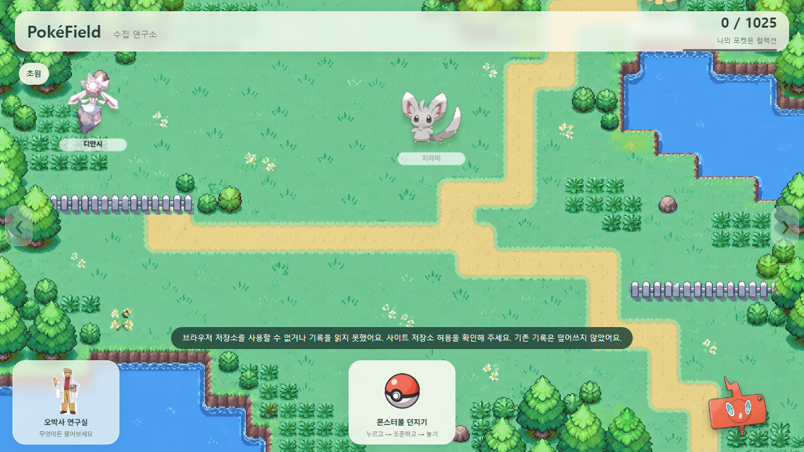

*IMG-15 · 부가 포획 저장 오류 / F2012 UI 참고 · 선행 실제 로컬 Chrome / 저장소 차단. 조건: localStorage 접근 차단. 결과: 안내·포획 중단 / 공용 SQLite 대체 없음. 일자: 2026-10-23 점검 기록(기존 캡처의 정확한 촬영 시각은 미기록). XLSX: 증빙!B574. 기존 범위 설명: 실제 로컬 Chrome의 저장소 접근 차단입니다. 포획 저장을 중단하고 공용 SQLite로 대체하지 않는 동작을 확인했습니다.*

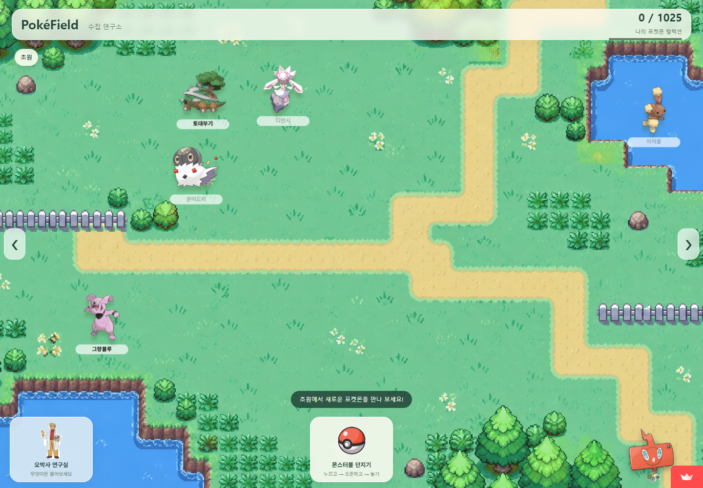

*IMG-16 · 배포·개인 저장 관찰 · 선행 실제 Cloud / 읽기 전용 / LLM 없음. 조건: 새 독립 A 최초·새로고침, 포획하지 않음. 결과: 0 / 1025 / Cloud 포획·Chroma·RAG 검증 아님. 일자: 2026-10-23 점검 기록(기존 캡처의 정확한 촬영 시각은 미기록). XLSX: 증빙!B607. 기존 범위 설명: 운영 Cloud의 읽기 전용 화면입니다. 최초·새로고침 모두 0건이며 포획하지 않았습니다. 개인 저장의 성공·원격 Chroma 로드·실제 RAG까지 검증한 증거는 아닙니다.*

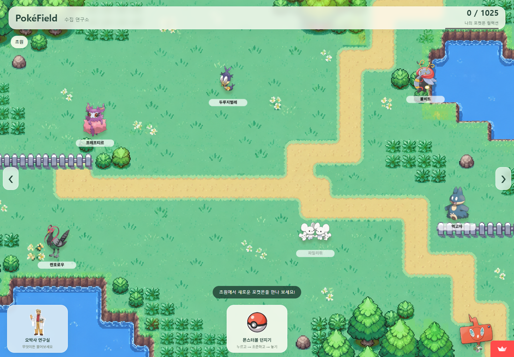

*IMG-17 · 배포·개인 저장 관찰 · 선행 실제 Cloud / 읽기 전용 / LLM 없음. 조건: 새 독립 B 최초·새로고침, 포획하지 않음. 결과: 0 / 1025 / A/B 모두 0인 사실만으로 저장 격리 통과 아님. 일자: 2026-10-23 점검 기록(기존 캡처의 정확한 촬영 시각은 미기록). XLSX: 증빙!B640. 기존 범위 설명: 독립 B도 0건입니다. 단순히 A/B가 모두 0인 사실만으로 포획 격리가 검증됐다고 판정하지 않습니다.*


## 1. 판정과 실행 이력

필수 F2001~F2012는 기록된 실행 범위에서 12/12입니다. 알려진 답변 품질 문제와 미실행 범위까지 통과했다는 뜻은 아닙니다. 심화 F2013~F2016은 **미선택**입니다.

| 실행 | 테스트 수·결과 | 시간 | 환경·범위 |
|---|---|---|---|
| 선행 NF 보완 회귀 | 155/155 통과 | 46.241초 | 기존 147개 + NF 8개입니다. 임시 DB·모의 HTTP·FakeLLM을 사용했습니다. |
| 후속 공식 체크리스트 회귀 | 155/155 통과 | 47.379초 | 실패·오류·건너뜀 0입니다. 격리 저장소·FakeLLM/FakeEmbeddings이며 유료 API를 차단했습니다. |

선행 [NF 기록](evidence/logs/nf-audit-results.json), 후속 [전체 로그](evidence/logs/current-tests.log)·[집계](evidence/logs/unit-summary.json)를 연결합니다. 두 실행을 합산하지 않습니다.

### 실제 GMS·로컬·캐시 결과

| 질문/검사 | 실행 종류 | 결과 | 시간 |
|---|---|---|---|
| 피카츄 특성 | 실제 GMS | 일반 정전기·숨겨진 피뢰침, 근거 1입니다. | 5.266초 |
| 피카츄 진화 | 실제 GMS | 라이츄와 진화 근거를 인용합니다. | 6.031초 |
| 팬텀 6→7 비교 | 실제 GMS | 부유→저주받은바디, 근거 2/1입니다. 모순된 확인 불가 문구가 붙는 **품질 실패**는 남아 있습니다. | 5.062초 |
| 2099년 가상 대회 도시 | 실제 GMS | 확인 불가로 답하며 도시를 생성하지 않았습니다. | 2.016초 |
| 피카츄 약점 | 로컬 Python | 땅 2배·일반 상성 기준입니다. | 0.125초 |
| 몸통박치기 검색 | 로컬 Python | 9세대 247마리, 첫 6마리와 버전/방법입니다. | 0.938초 |
| 반복 세대 비교 | 앱 응답 캐시 | cached=True·추가 HTTP 0입니다. | 0.000초, 반올림 |

실제 모델은 GMS `gpt-6.1-sol`이며 생성 **4회·입력 14,413·출력 252·총 14,665토큰**입니다. 추가 임베딩 HTTP는 0회입니다. [원본 실제 결과](evidence/logs/gms-live-results-20261023.json)를 제공합니다. 약점·기술·캐시는 실제 모델 호출 수에 넣지 않습니다.

### 브라우저·게임 이력

| 검사 | 결과와 범위 | 시간 |
|---|---|---|
| 조건 검색→선택→질문 | Chrome에서 특성·기술 첫/추가 페이지를 확인했습니다. | 개별 미기록 |
| 대화 기록 분리 | 전체·피카츄·라이츄 전환과 재진입 복원입니다. | 개별 미기록 |
| 선행 포획→도감 | 달코퀸 #0763, 실제 JS·격리 SQLite입니다. | 7.649초 |
| 후속 포획→도감 | 켄호로우 #0521, 실제 JS·격리 SQLite입니다. | 7.059초 |
| 연결 오류 | 실제 localhost 연결 거부와 AppTest의 안전한 안내·재시도입니다. | 개별 미기록 |
| PC/모바일 크기 | 1440×1000 / 390×844, 검사 범위 JS 예외·console.error 0입니다. | 개별 미기록 |

[후속 브라우저](evidence/logs/browser-results.json), [후속 게임·기록](evidence/logs/game-results.json), [선행 포획](verification/capture-history-results.json), [연결 오류](verification/connection-error-results.json)를 연결합니다. 브라우저 래퍼에는 FakeLLM이 장착됐지만 해당 검색·게임·기록 검사는 로컬 답변과 실제 JS/SQLite 경로입니다. 실유료 모델의 전체 UI 시연이나 모바일 실기기 시험은 아닙니다.

부가 서비스는 [PC 필드](evidence/screenshots/01-field-desktop-current.png), [도감](evidence/screenshots/02-dex-current.png), [포획→도감](evidence/screenshots/captured-dex.png) 원본으로 제공합니다. 캡처 대상은 함께 동봉한 game-results.json을 따릅니다.

## 2. 데이터·수집·색인 검증

다음은 [기존 백엔드 JSON](evidence/logs/current-backend-results.json)의 결과입니다. 긴 로그는 [원본 로그 시각화](evidence/screenshots/08-실제실행로그시각화-UI아님.png)로 보존하며 작은 이미지를 본문에 축소 삽입하지 않습니다. 로그 시각화는 앱 화면이 아닙니다.

| 요구사항 | 확인 결과 | 실행 범위 |
|---|---|---|
| F2001 | Catalog 6,260행 = meta 6,260건입니다. 1,025종·1,351형태와 구분합니다. | 실제 데이터와 복사 Chroma입니다. |
| F2001 | 피카츄 표본의 이름·타입·능력치·일반/숨겨진 특성을 확인했습니다. | 원문은 JSON의 sample_metadata입니다. |
| F2002 | meta upsert 두 번 모두 changed=0·skipped=6260·count=6260입니다. | 복사 DB이며 새 임베딩을 차단했습니다. |
| F2003 | 피카츄 / 피카츄 진화 / 피카츄 세대별 특징, 검색어 3개입니다. | 저장 Wikipedia 응답·과거 모델 JSON 재생입니다. |
| F2004 | 후보 8개 중 61168을 선택하고 종 자체 문서를 포함했습니다. | 신규 실수집이 아닙니다. |
| F2005 | docs 64청크이며 15개 문서-종 연결/10종 범위입니다. | 기존 저장 색인입니다. |
| F2005 | 1000/200→18, 500/100→36, 200/20→79청크입니다. | 동일 피카츄 문서·격리 DB·FakeEmbeddings입니다. 운영 전체 64개와 범위가 다릅니다. |
| NF2002 | 동일 질문 두 번 신규 HTTP/임베딩 0·변경 청크 0입니다. | 캐시 재사용입니다. |
| F2006 | k=1/3/5 → 필수 meta 포함 근거 2/4/6개, ID 중복 0입니다. | 복사 색인·질의 임베딩 캐시입니다. |
| F2007 | START→retrieve→generate→END입니다. | 기존 실제 그래프 구조 출력입니다. |

후보 ID는 61168·1641079·14779·857467·558873·2514891·35277·188035입니다. 선택되지 않은 ID는 candidate_ids와 selected_ids의 차집합으로 확인합니다. rejected 필드가 비었다고 모든 후보가 색인됐다는 뜻은 아닙니다. 청킹 실험은 청크 수 변화만 확인했으며 품질·비용·지연의 최적값 실험은 아닙니다.

[추가 증빙 필요: 실제 운영 연락처를 적용한 신규 Wikipedia 수집 진행·완료 화면입니다. 신규 실제 수집 성공으로 판정하지 않습니다.]

## 화면 증빙

### F2008 답변·인용·출처

아래 두 화면은 답변 번호와 대응하는 메타/외부 유형·제목·원문 링크를 함께 확인하는 기존 **FakeLLM UI**입니다. 실제 GMS 인용 검증 4사례는 별도 원본 JSON입니다.


*IMG-04 · F2008 · 기존 로컬 Chrome / FakeLLM UI. 조건: 답변 본문과 인용 번호 표시. 결과: 화면 표시 확인 / 실제 GMS 답변 화면 아님. 일자: 2026-10-23 점검 기록(기존 캡처의 정확한 촬영 시각은 미기록). XLSX: 증빙!B211. 기존 범위 설명: F2008 답변 본문 화면입니다. FakeLLM이며 원본 이미지를 클릭해 확대할 수 있습니다.*


*IMG-05 · F2006·F2008 · 기존 로컬 Chrome / FakeLLM UI. 조건: 근거 목록 펼침·메타/외부 유형·제목·링크. 결과: 유형·번호·원문 표시 확인 / 실제 GMS 화면 아님. 일자: 2026-10-23 점검 기록(기존 캡처의 정확한 촬영 시각은 미기록). XLSX: 증빙!B244. 기존 범위 설명: F2008 대응 근거 화면입니다. FakeLLM이며 실제 유료 생성 화면이 아닙니다.*

### F2007·F2009·F2010·F2011

| 항목 | 읽을 수 있는 원본 화면·로그 | 범위 |
|---|---|---|
| 근거 없음 | [무인용 UI](evidence/screenshots/07-no-evidence-FakeLLM-current.png), [실제 GMS](evidence/logs/gms-live-results-20261023.json) | FakeLLM UI와 실제 확인 불가 답변 로그를 구분합니다. |
| 기록 분리 | [선택형 모바일 화면](evidence/screenshots/game-mobile-chat.png), [기록 로그](evidence/logs/game-results.json) | 로컬 답변·Chrome 화면 크기 모의입니다. |
| 특성 검색 연결 | [선택→질문 화면](evidence/screenshots/ability-chat.png), [브라우저 로그](evidence/logs/browser-results.json) | 실제 Chrome·로컬 답변입니다. |
| 기술 검색 연결 | [기술 결과 화면](evidence/screenshots/moves-chat.png), [첫/추가 페이지 로그](evidence/logs/browser-results.json) | 첫·추가 페이지 모두 기존 검증입니다. |
| 세대 비교 | [실제 GMS 결과](evidence/logs/gms-live-results-20261023.json), [155개 회귀](evidence/logs/current-tests.log) | 변경 계산·두 세대 인용은 확인됐지만 모순 문구는 미해결입니다. |

[추가 증빙 필요: 실제 GMS 팬텀 6→7 답변과 두 세대 근거가 함께 보이는 원래 UI 화면입니다. 로그만 존재하며 재현 화면을 실제 결과로 만들지 않았습니다.]

### F2012 진행·오류 안내


*IMG-10 · F2012 · 기존 로컬 Chrome / FakeLLM UI. 조건: 답변 생성 대기 상태. 결과: 스피너 표시 / 실제 GMS 지연 측정·신규 수집 진행 아님. 일자: 2026-10-23 점검 기록(기존 캡처의 정확한 촬영 시각은 미기록). XLSX: 증빙!B409. 기존 범위 설명: 기존 FakeLLM 생성 스피너입니다. 실제 GMS의 지연시간·토큰 증거가 아닙니다.*

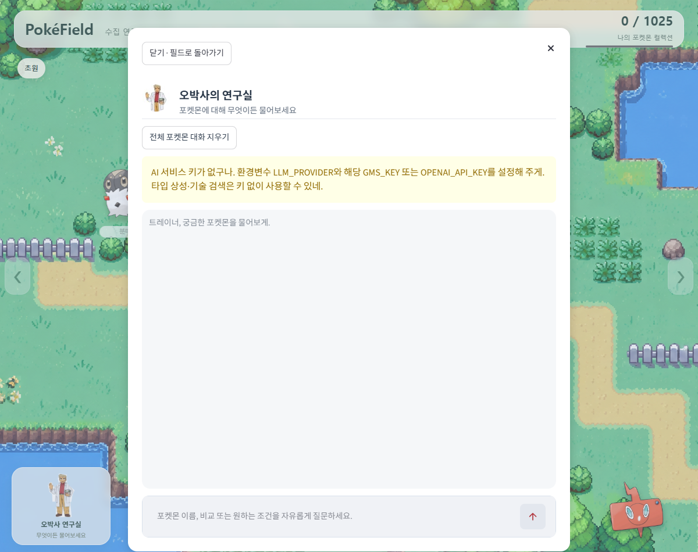

*IMG-11 · F2012·NF2004 · 기존 격리 로컬 Chrome. 조건: API 키 없는 환경에서 채팅 진입. 결과: 설정 안내 표시 / 운영 키 삭제·실제 비밀값 노출 없음. 일자: 2026-10-23 점검 기록(기존 캡처의 정확한 촬영 시각은 미기록). XLSX: 증빙!B442. 기존 범위 설명: F2012 · 격리 로컬 Streamlit의 키 누락 안내입니다. 실제 운영 키를 제거한 화면이 아닙니다.*

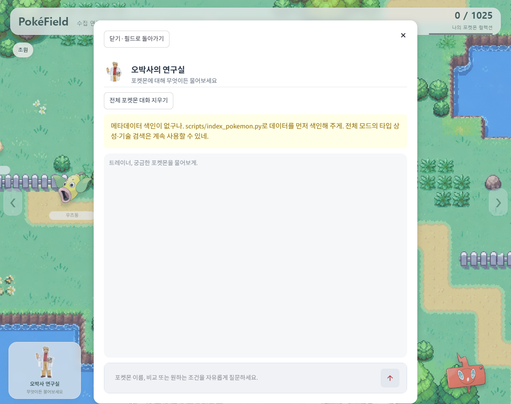

*IMG-12 · F2012·NF2004 · 기존 격리 로컬 Chrome. 조건: 빈 테스트 색인으로 채팅 진입. 결과: 색인 안내 표시 / 운영 Chroma 변경 없음. 일자: 2026-10-23 점검 기록(기존 캡처의 정확한 촬영 시각은 미기록). XLSX: 증빙!B475. 기존 범위 설명: F2012 · 격리 로컬 Streamlit의 빈 색인 안내입니다. 운영 ChromaDB를 수정하지 않았습니다.*

두 화면은 원본 크기로 확인할 수 있습니다. 격리 환경이며 운영 키·색인을 삭제하지 않았습니다. 연결 오류는 [localhost 실제 연결 거부와 AppTest](verification/connection-error-results.json)의 범위입니다. 실제 외부 401/429/5xx 장애를 재현한 것은 아닙니다.

## 3. 공식 셀프 체크리스트 — 최신 27항목

[수정한 공식 XLSX](evidence/checklists/Pokefield_셀프점검결과_20261023.xlsx)의 셀프 G9:I35를 갱신하고 실제 이미지 27개를 내장한 `증빙` 시트를 추가했습니다. 작성자·점검자·서명·상호 영역과 공식 항목·시트·서식·병합·유효성·수식은 보존했습니다. H열은 이미지 번호와 **증빙 시트의 셀 위치**를 가리킵니다. 원본 상대경로는 증빙 시트와 아래 목록에 보존합니다. 수정 전 파일은 별도 백업했습니다.

| 통과 | 실패 | 미확인 | 해당없음 | 미기입 | 전체 |
|---|---|---|---|---|---|
| 16 | 2 | 3 | 6 | 0 | 27 |

선행 18/0/3/6과 기존 27개 행의 설명은 [재판정 전 원문](evidence/logs/selfcheck-before-refresh-20261023.txt) 및 [기존 판정 JSON](evidence/logs/assessments.json)에 보존했습니다. 해당 파일은 과거 시점의 기록이며 현재 XLSX 판정과 구분합니다. 원본 XLSX 백업은 별도 보존하고 작성자·상호 정보는 덮어쓰지 않았습니다.

COUNTIF/COUNTA 집계 수식은 기존 원식을 유지합니다. 임시 입력 변경 시 집계가 따라 바뀌는 것을 검사하고 복원했으며, Microsoft Excel에서 읽기 전용 열기·전체 계산으로 16/2/3/6/0/27을 확인했습니다. [양식 보존 검사](evidence/logs/latest-xlsx-preservation.json)와 [Excel 열기 검사](evidence/logs/latest-excel-open-check.json)입니다.

| 번호 | 요구사항 | 최신 판정 | 결과·남은 범위 | 증빙 |
|---|---|---|---|---|
| 1 | F2001 | 통과 | 현재 Catalog 6,260행=복사 Chroma meta 6,260건. 피카츄 표본 속성 확인. 원본 색인 미수정. | [latest-backend-security-results.json](evidence/logs/latest-backend-security-results.json) · IMG-01 · 증빙!B50 |
| 2 | F2002 | 통과 | 최신 격리 FakeEmbeddings 중복 색인 회귀 통과. 기존 복사 DB 2회 changed=0 이력과 구분. | [latest-unit-tests-20261023.log](evidence/logs/latest-unit-tests-20261023.log) · [current-backend-results.json](evidence/logs/current-backend-results.json) · IMG-03 · 증빙!B116 |
| 3 | F2003·F2004 | 통과 | 기존 저장 Wiki 응답·모델 JSON 재생: 검색어3개/후보8개 중61168 선택. 신규 실제 API 아님. | [current-backend-results.json](evidence/logs/current-backend-results.json) · [latest-unit-tests-20261023.log](evidence/logs/latest-unit-tests-20261023.log) · IMG-03 · 증빙!B116 |
| 4 | F2004·NF2002 | 통과 | 기존 반복 수집 신규 HTTP/임베딩0·변경0. 최신 캐시 회귀 통과. 운영 재수집 미실행. | [current-backend-results.json](evidence/logs/current-backend-results.json) · [latest-unit-tests-20261023.log](evidence/logs/latest-unit-tests-20261023.log) · IMG-03 · 증빙!B116 |
| 5 | F2005 | 통과 | 기존 동일 문서 1000/200→18,500/100→36,200/20→79. 격리 FakeEmbeddings. 이번 재색인 없음. | [current-backend-results.json](evidence/logs/current-backend-results.json) · IMG-03 · 증빙!B116 |
| 6 | F2006 | 통과 | 기존 k=1/3/5→필수 meta 포함2/4/6개. 최신 선택형 메타 병합·인용 회귀 통과. Cloud 미검증. | [current-backend-results.json](evidence/logs/current-backend-results.json) · [latest-unit-tests-20261023.log](evidence/logs/latest-unit-tests-20261023.log) · IMG-03 · 증빙!B116 |
| 7 | F2007 | 통과 | 현재 build_graph 출력 START→retrieve→generate→END 확인. 신규 LLM 호출 없음. | [latest-backend-security-results.json](evidence/logs/latest-backend-security-results.json) · IMG-01 · 증빙!B50 |
| 8 | F2008 | 통과 | 기존 FakeLLM UI 번호·유형·제목·링크와 실제 GMS 인용 로그. 최신 인용 검증 회귀 통과. | [04b-external-citations-FakeLLM-current.png](evidence/screenshots/04b-external-citations-FakeLLM-current.png) · [gms-live-results-20261023.json](evidence/logs/gms-live-results-20261023.json) · IMG-04 · 증빙!B211 / IMG-05 · 증빙!B244 |
| 9 | F2007·F2008 | 통과 | 기존 실제 GMS 확인 불가 답변과 별도 FakeLLM 무인용 안내. 최신 근거 검증 회귀 통과. | [07-no-evidence-FakeLLM-current.png](evidence/screenshots/07-no-evidence-FakeLLM-current.png) · [gms-live-results-20261023.json](evidence/logs/gms-live-results-20261023.json) · IMG-06 · 증빙!B277 |
| 10 | F2009 | 통과 | 최신 전체/선택 대화·순서 회귀 통과. 기존 Chrome 전환·재진입 기록. 계정별 장기 보관 아님. | [latest-unit-tests-20261023.log](evidence/logs/latest-unit-tests-20261023.log) · [game-results.json](evidence/logs/game-results.json) · IMG-07 · 증빙!B310 |
| 11 | F2011 | 통과 | 최신 타입·특성·수치·기술 필터 회귀 통과. 첫/추가 페이지 질문 연결은 기존 로컬 Chrome 이력. | [latest-unit-tests-20261023.log](evidence/logs/latest-unit-tests-20261023.log) · [browser-results.json](evidence/logs/browser-results.json) · IMG-08 · 증빙!B343 / IMG-09 · 증빙!B376 |
| 12 | F2010 | 통과 | 변경 계산·두 세대 근거 회귀 통과. 기존 실제 GMS 비교 인용 확인. 모순 문구 품질 문제 별도 미해결. | [latest-unit-tests-20261023.log](evidence/logs/latest-unit-tests-20261023.log) · [gms-live-results-20261023.json](evidence/logs/gms-live-results-20261023.json) · IMG-02 · 증빙!B83 |
| 13 | F2012 | 통과 | 최신 진행/키·색인 안내 회귀와 기존 FakeLLM 스피너·격리 오류 UI. 실제 신규 수집 화면 미확보. | [latest-unit-tests-20261023.log](evidence/logs/latest-unit-tests-20261023.log) · [06-missing-key-current.png](evidence/screenshots/06-missing-key-current.png) · IMG-10 · 증빙!B409 / IMG-11 · 증빙!B442 / IMG-12 · 증빙!B475 |
| 14 | 위험 도메인 | 해당없음 | 포켓몬 게임 도메인. 건강·금융 등 판단 위험 도메인 항목 비해당. | [README.md](../README.md) · 해당없음 · 이미지 없음 / 증빙!B38 (미선택·비해당) |
| 15 | F2013 | 해당없음 | 심화 F2013 미선택. 맵/도감 직접 UI만 부분 구현. 전체 프론트·서버 분리 완료 아님. | [requirements.md](requirements.md) · 해당없음 · 이미지 없음 / 증빙!B38 (미선택·비해당) |
| 16 | F2014 | 해당없음 | 심화 F2014 미선택·MMR 미구현. 비교 결과 생성 안 함. | [architecture.md](architecture.md) · 해당없음 · 이미지 없음 / 증빙!B38 (미선택·비해당) |
| 17 | F2015 | 해당없음 | 심화 F2015 미선택·전후 5문항 비교 미구현. 기존 GMS4회는 대조 실험 아님. | [requirements.md](requirements.md) · 해당없음 · 이미지 없음 / 증빙!B38 (미선택·비해당) |
| 18 | F2015 | 해당없음 | 심화 F2015 미선택. 전후 비교 제출 문서 없음. | [requirements.md](requirements.md) · 해당없음 · 이미지 없음 / 증빙!B38 (미선택·비해당) |
| 19 | F2016 | 해당없음 | 심화 F2016 미선택·미충족. pokemon_docs는 한국어 Wikipedia 한 출처. meta 유형과 구분. | [latest-backend-security-results.json](evidence/logs/latest-backend-security-results.json) · [current-backend-results.json](evidence/logs/current-backend-results.json) · 해당없음 · 이미지 없음 / 증빙!B38 (미선택·비해당) |
| 20 | NF2001 | 미확인 | 기존 실제 GMS2.016~6.031초. 사용자 사용성 합격·Cloud 처리시간·부하/p95 미검증. 새 유료 호출 없음. | [nf-audit-results.json](evidence/logs/nf-audit-results.json) · [gms-live-results-20261023.json](evidence/logs/gms-live-results-20261023.json) · 이미지 없음 · 증빙!B39 / [추가 증빙 필요] 사용성 확인 |
| 21 | NF2003·NF2004 | 통과 | 현재 텍스트102개 실제 설정 키 일치0·최신 UI 비노출 AppTest 통과. 최종 제출 패키지 전수 검사는 별도. | [latest-backend-security-results.json](evidence/logs/latest-backend-security-results.json) · [latest-unit-tests-20261023.log](evidence/logs/latest-unit-tests-20261023.log) · IMG-11 · 증빙!B442 / IMG-12 · 증빙!B475 |
| 22 | NF2005 | 통과 | 현재 수집/색인/검색/생성/UI 모듈과 retrieve→generate 구조 확인. 최신 격리163개 통과. | [latest-backend-security-results.json](evidence/logs/latest-backend-security-results.json) · [architecture.md](architecture.md) · IMG-01 · 증빙!B50 |
| 23 | NF2006 | 미확인 | WIKI_CONTACT 미설정. 최신 간격·재시도·헤더 모의 테스트 통과. 실제 운영 연락처 적용·송신 미실행. | [latest-backend-security-results.json](evidence/logs/latest-backend-security-results.json) · [latest-unit-tests-20261023.log](evidence/logs/latest-unit-tests-20261023.log) · 이미지 없음 · 증빙!B40 / [추가 증빙 필요] 실제 위키 식별 전송 |
| 24 | NF2007 | 통과 | 위키15개·자산15개 출처/조건 기록 존재. 기록 여부 통과이며 실제 권리 확보·공개 배포 허락은 미확인. | [SOURCES_AND_LICENSES.md](SOURCES_AND_LICENSES.md) · [asset_provenance.json](asset_provenance.json) · 증빙!B41 (출처 문서 근거) / 앱 이미지 없음 |
| 25 | 필수 전체 | 미확인 | 로컬163/163 통과. Cloud 새A/B0건·재접속만 확인. 실제 Cloud 포획 저장·Chroma/RAG 미검증. 심화 미선택. | [latest-unit-tests-20261023.log](evidence/logs/latest-unit-tests-20261023.log) · [latest-cloud-readonly-results.json](evidence/logs/latest-cloud-readonly-results.json) · IMG-13 · 증빙!B508 / IMG-16 · 증빙!B607 / IMG-17 · 증빙!B640 |
| 26 | 전체 캡처 | 실패 | 전체 첨부 미완료 확인: 실제 신규 Wiki 수집 진행/완료·실제 GMS 팬텀 비교 UI 없음. 기존 캡처로 대체 불가. | [VERIFICATION_SUMMARY.md](VERIFICATION_SUMMARY.md) |
| 27 | 전체 산출물 | 실패 | 현재 정의서·설계·소스·README·셀프는 존재. 실제 다른 교육생의 상호 결과가 없고 빈 양식뿐이므로 전체 자료 미완료. | [VERIFICATION_SUMMARY.md](VERIFICATION_SUMMARY.md) · [상호체크리스트_빈양식.md](evidence/checklists/상호체크리스트_빈양식.md) |

### 판정 변경 사유

| 번호 | 선행 → 최신 | 이유 |
|---|---|---|
| 25 | 통과 → 미확인 | 로컬 필수 기능 검증과 Cloud 전체 서비스 검증을 구분했습니다. Cloud 포획 저장·원격 Chroma/RAG는 미실행이며 전체 제출 준비 통과로 확장하지 않습니다. |
| 26 | 미확인 → 실패 | 전수 대조 결과 신규 실제 Wikipedia 수집 진행/완료·실제 GMS 팬텀 비교 UI가 없다는 것을 확인했습니다. 증빙의 전체 첨부 조건을 충족하지 못했습니다. |
| 27 | 통과 → 실패 | 요구사항 정의서 6장의 실제 상호 점검 결과가 없습니다. 빈 양식 존재를 상호 결과 제출 완료로 간주하지 않습니다. |

기능 자체의 F2001~F2012 판정은 기록된 로컬 범위의 기존 12/12이며 이번 제출 준비 25~27번과 구분합니다. 12번 F2010의 인용 기능 통과와 별도 답변 품질 문제도 함께 유지합니다. 24번은 출처/조건 **기록** 통과이며 NF2007의 실제 권리 확보를 통과로 바꾸지 않습니다. NF2001·NF2006과 25번은 미확인입니다.

### 최신 XLSX 미리보기

아래는 실제 수정 XLSX를 렌더링한 미리보기이며 **앱 실행 캡처나 Excel UI 스크린샷이 아닙니다**. 개인 이름·서명 영역은 포함하지 않았습니다. Excel에서 정상 열리는지는 별도 실제 검사 로그로 증명합니다.

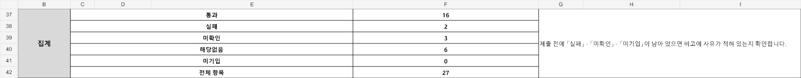

*COUNTIF/COUNTA의 최신 집계입니다. 고정 숫자로 집계 수식을 대체하지 않았습니다.*

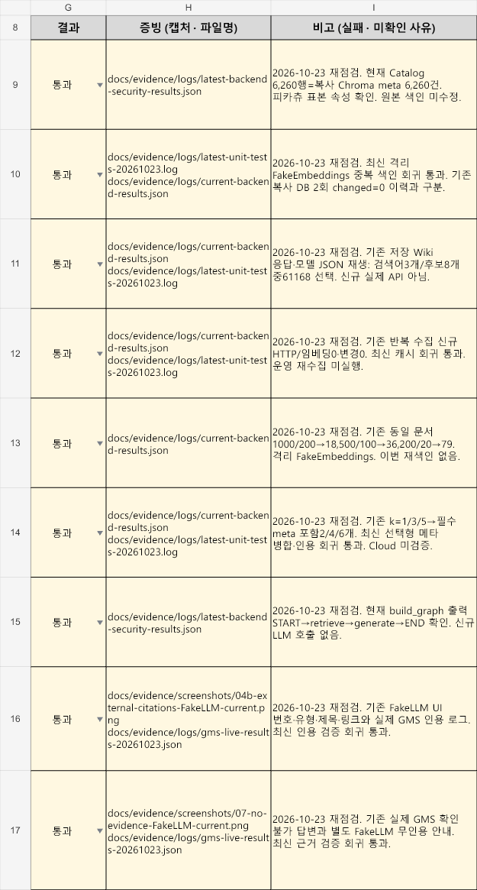

*원본 양식 G/H/I의 1~9번입니다. 셀 서식과 공식 항목은 유지했습니다.*

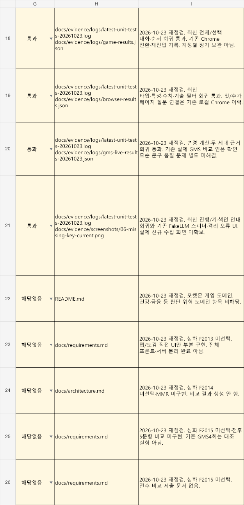

*10~18번의 최신 증빙·실행 범위입니다. 심화 미선택은 해당없음입니다.*

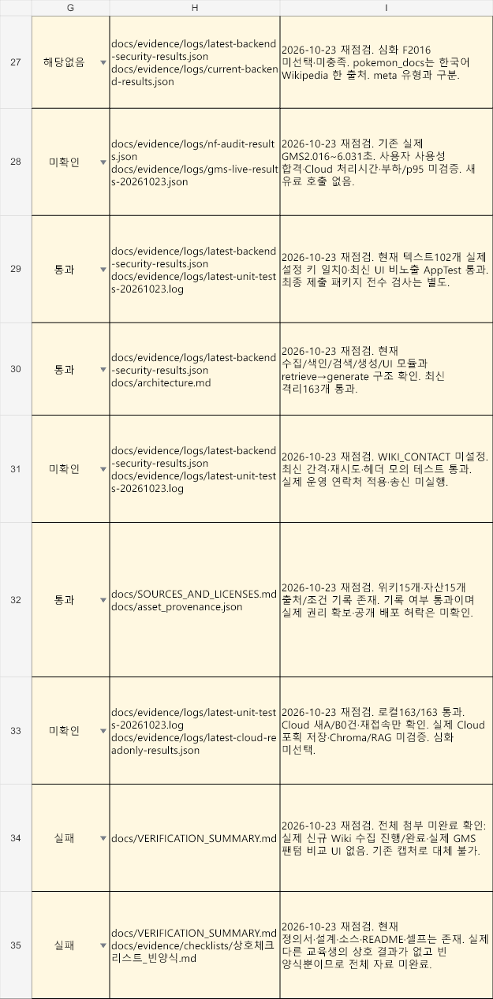

*19~27번이며 미확인 20·23·25와 실패 26·27을 그대로 표시합니다.*

상호 결과·평가자·서명을 임의 작성하지 않았습니다. 기존 상호 빈 양식은 보존하며 다른 교육생의 실제 점검 결과가 필요합니다.

## 4. 비기능·제출 전 확인

[NF2001~NF2007 판정과 측정](NF_VERIFICATION.md), [출처·이용 조건](SOURCES_AND_LICENSES.md)을 연결합니다. NF2001·NF2006·NF2007은 확인 필요를 유지합니다.

| 제출 확인 | 현재 상태·필요 조치 |
|---|---|
| 정의서·설계·현재 소스·README | 현재 프로젝트 자료를 사용합니다. 과거 패키지의 소스 사본과 혼동하지 않습니다. |
| 필수 기능 | 기록된 범위 12/12이며 모든 네트워크·버전·모바일 환경의 완전성을 보장하지 않습니다. |
| 심화 | F2013~F2016 미선택이며 비교 결과를 만들지 않습니다. |
| 테스트·화면·로그 | 기존 이력과 최신 163개 회귀·실제 로컬 브라우저·Cloud 읽기를 구분합니다. 실제 GMS는 과거 결과만 있습니다. |
| 셀프 | 공식 양식·평가자·상호 정보를 보존하고 셀프 G/H/I를 최신 16/2/3/6으로 갱신했습니다. 사람의 최종 검토가 필요합니다. |
| 상호 | 실제 다른 교육생의 점검 결과가 필요합니다. |
| 운영·권리 | 사용성 의견, 실제 연락처 전송, 이미지/원작 콘텐츠 허락이 미확인입니다. |
| 최종 전달 | 최종 제출 폴더의 키·개인정보·캐시 제외·라이선스 고지와 경로를 다시 확인해야 합니다. ZIP은 생성하지 않았습니다. |

보안 수치는 선행 NF 95개, 후속 텍스트 112개, 정리 단계 텍스트 156개·조건부 데이터/색인 4,572개로 대상 범위가 다릅니다. [후속 보안](evidence/logs/current-security.json)과 [정리 검사](evidence/logs/cleanup-integrity-security-check.json)를 합산하지 않습니다.

추가 미실행은 외부 API 401/429/5xx 실제 장애, 실기기 모바일, 새 장치 전체 설치, 운영 SLA·동시성·p95입니다. MMR·비RAG 비교는 미선택입니다. 팬텀 답변 모순 문구는 별도 코드 수정이 필요한 상태이며 이번 작업에서는 수정하지 않았습니다.


<a id="브라우저-포획-저장-및-cloud-확인-2026-10-23"></a>

## 선행 브라우저 포획 저장 및 Cloud 확인 (2026-10-23)

기존 155개 테스트·SQLite 포획 화면·실제 GMS 수치는 과거 실행 이력으로 유지합니다. 아래 검증은 개인별 포획 저장 변경에 관한 별도 결과이며 기존 실제 GMS 4회와 합산하지 않습니다. 해당 브라우저 저장 검증의 LLM·임베딩·재색인 호출은 0회입니다.

| 검사 | 실행 결과 | 범위·증빙 |
|---|---|---|
| 저장 보완 후 전체 회귀 | 163/163 통과, 45.941초 | 선행 격리 실행입니다. [전체 로그](evidence/logs/browser-storage-unit-tests-isolated.log)입니다. 첫 sandbox 실행의 임시파일 교체 권한 오류 후 격리 환경에서 재실행한 결과이며 API 호출은 없습니다. |
| 선행 브라우저 저장 관련 회귀 | 8/8 통과 | [현재 실행 로그](evidence/logs/browser-storage-targeted-tests.log)입니다. 전체 163개를 이번 편집에서 다시 실행한 것은 아닙니다. |
| 기존 A/B·복원·도감 | 실제 로컬 Chrome 통과 | 별개 프로필 초기 0·독립 포획·새 Streamlit 세션/새 탭 복원·동일 프로필 탭 동기화·포획→팝업→도감입니다. [로그](evidence/logs/browser-storage-browser-results.json)와 [현재 코드 일치 검사](evidence/logs/browser-storage-source-check.json)를 제공합니다. |
| 저장 실패·멱등·이관 방지 | 모의 ACK 검사 통과 | 실제 생산 JS와 localStorage이며 서버 응답만 모의입니다. [별도 결과](evidence/logs/browser-storage-storage-edge-results.json)입니다. 실제 Cloud backend 검사가 아닙니다. |
| 실제 Cloud 접근 | 필드 표시, JS pageerror 0 | https://pokefield.streamlit.app/ 의 실제 화면입니다. 샌드박스 DNS 제한으로 첫 접근 실패 후 허용된 네트워크에서 접속했습니다. |
| 실제 Cloud A/B 읽기·새로고침 | 현재 개인별 저장 적용 확인 불가 | 두 새 독립 프로필 모두 최초/재접속 `22 / 1025`, `pokefield:` localStorage 키 0개입니다. [Cloud 원본 로그](evidence/logs/cloud-readonly-results.json)입니다. 공유 원천의 종류나 배포 커밋은 UI만으로 단정하지 않습니다. |

개별 브라우저 동작의 응답 시간은 기록되지 않아 수치를 추가하지 않습니다. Cloud에서는 운영 데이터 보존을 위해 포획·채팅·수집·색인 작업을 수행하지 않았습니다. Cloud의 실제 LLM·Chroma 컬렉션 수·새 포획 저장·모바일 실기기는 추가 검증 대상입니다.

### 기존 실제 로컬 브라우저 증빙


*IMG-23 · 부가 개인 저장·도감 · 선행 실제 로컬 Chrome / localStorage. 조건: 브라우저 저장 보완 당시 A 복원. 결과: 개인 도감 표시 / 최신 재실행 화면 IMG-13과 구분. 일자: 2026-10-23 점검 기록(기존 캡처의 정확한 촬영 시각은 미기록). XLSX: 증빙!B838. 기존 범위 설명: 개인 기록의 도감 표시를 확인한 로컬 화면입니다. Cloud 화면이 아닙니다.*

[실제 로컬 포획→도감 원본](evidence/screenshots/browser-A-field-dex.png), [저장소 차단 안내 원본](evidence/screenshots/browser-storage-blocked.png)도 보존합니다.

### 선행 실제 Cloud 증빙


*IMG-26 · 배포 과거 관찰 · 과거 실제 Cloud / 읽기 전용. 조건: 과거 새 A 최초·새로고침, 포획하지 않음. 결과: 22 / 1025 / 이후 0건 화면과 다른 과거 이력. 일자: 2026-10-23 점검 기록(기존 캡처의 정확한 촬영 시각은 미기록). XLSX: 증빙!B937. 기존 범위 설명: 운영 Cloud의 읽기 전용 캡처입니다. 새 개인 저장 키 없이 22건을 표시합니다. 포획·LLM 호출은 실행하지 않았습니다.*

[새 독립 프로필 B 원본](evidence/screenshots/cloud-B.png)은 같은 수집 수를 표시합니다. 위 로컬 검증과 혼동하지 않습니다.

### 배포 이후 추가 확인 절차

1. 운영자가 Cloud 관리 화면에서 저장소·브랜치·커밋이 브라우저 저장 보완본인지 확인합니다. 이번 작업에서는 배포·push를 하지 않았습니다.
2. 수정본 적용 후 직접 서비스 URL의 새 프로필 A/B가 각 0건인지 확인합니다. 기존 공용 22건을 자동 이관하면 안 됩니다.
3. A/B에서 각각 포획하여 수집 수·중복 횟수·팝업·도감을 확인하고, 상대 프로필 수가 변하지 않는지 확인합니다.
4. 각 프로필 새로고침·동일 프로필 새 탭 복원과 도감 표시를 확인합니다. 모바일 저장소·차단 상황도 추가 확인합니다.
5. 현재 Cloud Secrets의 값은 촬영하지 않고 설정명·Python 버전과 Chroma 로드 건수만 별도 안전한 증빙으로 확보합니다.

[추가 검증 필요: 수정본 Cloud A/B 독립 포획·새로고침 복원·수집 수·도감 화면과 배포 커밋 확인입니다. 현재 읽기 결과만으로 통과 판정을 추가하지 않습니다.]

<a id="chapter4-evidence"></a>

## 요구사항 정의서 4장 전체 증빙 대조 (4.1~4.8)

대조 원문은 「AI코어프로젝트_2회차_요구사항정의서」 18~19쪽입니다. 아래 40개 행은 원문의 확인 항목을 나눈 **증빙 연결 현황**이며 요구사항 통과 수나 공식 27항목 판정과 다릅니다. ‘연결 완료’는 해당 기록을 찾고 연결했다는 뜻입니다. 과거 실행은 현재 코드의 모든 경로를 다시 실행한 결과가 아닙니다. ‘부분 증빙’은 로그·모의 실행·기존 캡처의 범위를 제한하거나 실제 추가 검증이 필요한 상태입니다.

이 4장 연결표는 선행 편집의 기록입니다. 최신 격리 회귀·브라우저 검사 및 변경된 제출 판정은 최신 재점검/셀프 절로 보완합니다. 유료 API·재색인·상호 평가는 실행하지 않았습니다. 기존 155/163/8개 이력과 실제 GMS 호출 수는 변경하지 않았습니다. 독립적인 앱 화면은 가능한 한 한 번만 삽입하고 여러 확인 항목에서 같은 화면을 참조합니다.

<a id="verify-4-1"></a>

### 4.1 데이터와 색인 확인 (F2001~F2002)

| 확인 항목 | 증빙 연결 상태 | 실제 결과·범위 | 화면·원본 |
|---|---|---|---|
| 로드 수·색인 수 | 연결 완료 | 6,260 세대 행 = meta 6,260건입니다. 종 1,025·형태 1,351과 구분합니다. 복사 Chroma입니다. | [백엔드 JSON](evidence/logs/current-backend-results.json) |
| 두 번 색인·중복 방지 | 연결 완료 | 두 번 모두 changed=0, skipped=6260, count=6260입니다. 새 임베딩은 차단했습니다. | [백엔드 JSON](evidence/logs/current-backend-results.json) |
| 항목 1건 색인 텍스트 | 연결 완료 | pokemon:25:gen:9의 타입·종족값·일반/숨겨진 특성과 출처를 실제 출력했습니다. | [백엔드 JSON](evidence/logs/current-backend-results.json) |

로그만 있는 항목은 아래와 같이 원본 필드 값을 전사합니다. 새 실행·앱 화면이 아닙니다.

```text
metadata_rows = 6260
counts = {pokemon_meta: 6260, pokemon_docs: 64}
index_twice[0] = {changed: 0, skipped: 6260, count: 6260}
index_twice[1] = {changed: 0, skipped: 6260, count: 6260}
```

피카츄 색인 표본은 원본 `sample_metadata.text`입니다. 아래 null은 당시 원시 색인 텍스트이며 UI 출력이 아닙니다.

```text
피카츄 (pikachu) | species_id=25, pokemon_id=25 | 9세대
타입: 전기(electric)
종족값: {"HP": 35, "공격": 55, "방어": 40, "특수": null, "특수공격": 50, "특수방어": 50, "스피드": 90}
특성: [{"name": "static", "name_ko": "정전기", "is_hidden": false}, {"name": "lightning-rod", "name_ko": "피뢰침", "is_hidden": true}]
게임별 등장 여부: 미확인. 이력 상태: api_history_reconstructed
```

<a id="verify-4-2"></a>

### 4.2 문서 수집과 색인 확인 (F2003~F2005)

| 확인 항목 | 증빙 연결 상태 | 실제 결과·범위 | 화면·원본 |
|---|---|---|---|
| 프롬프트 1 검색어 목록 | 연결 완료 | 피카츄 / 피카츄 진화 / 피카츄 세대별 특징입니다. 저장된 모델 JSON 재생입니다. | [백엔드 JSON](evidence/logs/current-backend-results.json) |
| 프롬프트 2 선별·버린 문서 | 연결 완료 | 8개 후보 중 61168을 선택했습니다. 비선택 7개는 후보와 선택의 차집합입니다. | [백엔드 JSON](evidence/logs/current-backend-results.json) |
| 같은 질문 재수집 방지 | 연결 완료 | 반복 수집 new_http=0·new_embeddings=0·변경 청크 0입니다. 캐시 결과입니다. | [백엔드 JSON](evidence/logs/current-backend-results.json) |
| 선택 항목 자체 문서 포함 | 부분 증빙 | own_document=true, 25_61168.json입니다. 저장 Wikipedia 응답 재생이며 실제 신규 수집은 미실행입니다. | [백엔드 JSON](evidence/logs/current-backend-results.json) |
| 청크 설정 변경·색인 수 | 연결 완료 | 1000/200→18, 500/100→36, 200/20→79입니다. 동일 문서·격리 DB·FakeEmbeddings입니다. | [백엔드 JSON](evidence/logs/current-backend-results.json) |

| 저장 수집 재생 필드 | 원본 값 |
|---|---|
| candidate_ids | 61168, 1641079, 14779, 857467, 558873, 2514891, 35277, 188035 |
| selected_ids / documents | [61168] / [25_61168.json] |
| 비선택 ID (차집합) | 1641079, 14779, 857467, 558873, 2514891, 35277, 188035 |
| own_document / llm_replay_calls | true / 2 (실제 LLM 호출이 아닙니다.) |
| 반복 수집 | new_http=0 / new_embeddings=0 / changed_first=0 / changed_second=0 |

원본 `rejected=[]`만으로 모든 후보가 색인됐다고 해석하지 않습니다. 비선택 ID는 위 차집합으로 계산했으며 그 문서를 거절한 이유를 임의로 생성하지 않습니다.

[추가 증빙 필요: 실제 운영 연락처가 설정된 환경에서 문서 수집 버튼을 눌렀을 때 검색어·후보·수집 진행·완료와 자체 문서가 확인되는 화면입니다. 현재 연락처 확인이 남아 있고 신규 수집에는 모델 비용이 발생할 수 있어 이번 작업에서는 실행하지 않았습니다.]

<a id="verify-4-3"></a>

### 4.3 답변과 근거 확인 (F2006~F2008)

| 확인 항목 | 증빙 연결 상태 | 실제 결과·범위 | 화면·원본 |
|---|---|---|---|
| 같은 질문·Top-k 변경 | 연결 완료 | k=1/3/5에서 근거 총 2/4/6개입니다. 필수 선택 meta 1개 + 외부 최대 k개이며 중복 ID 0입니다. | [백엔드 JSON](evidence/logs/current-backend-results.json) |
| retrieve·generate 두 노드 | 연결 완료 | 원본 graph 출력은 __start__→retrieve→generate→__end__입니다. 현재 build_graph와 일치합니다. | [백엔드 JSON](evidence/logs/current-backend-results.json) · [현재 코드](../src/rag.py) |
| 본문 번호·목록 일치 | 연결 완료 | FakeLLM UI의 번호/목록과 실제 GMS 로그의 valid_citations=true를 구분합니다. | [본문 화면](evidence/screenshots/04-citations-FakeLLM-current.png) · [실제 GMS](evidence/logs/gms-live-results-20261023.json) |
| meta·외부 문서 유형 구분 | 연결 완료 | 번호·유형·제목·원문 링크의 기존 FakeLLM UI입니다. | [근거 화면](evidence/screenshots/04b-external-citations-FakeLLM-current.png) |
| 없는 사실 추측하지 않음 | 연결 완료 | 실제 GMS 2099년 가상 대회 질문의 확인 불가 응답입니다. 기존 로그만 있으며 새 생성이 아닙니다. | [실제 GMS](evidence/logs/gms-live-results-20261023.json) |
| 인용 없는 경우 안내 | 연결 완료 | 무인용 안내가 실제 로컬 FakeLLM UI에 표시됩니다. | [무인용 화면](evidence/screenshots/07-no-evidence-FakeLLM-current.png) |

| Top-k | 실제 근거 ID(원본 순서, 축약 접두사 표기) |
|---|---|
| 1 | pokemon:25:gen:9; wiki:61168:f1410c75ca:2 |
| 3 | 위 meta; wiki 청크 2, 0, 3 |
| 5 | 위 meta; wiki 청크 2, 0, 3, 12, 6 |

외부 ID의 전체 접두사는 `species:25:`입니다. 각 k의 전체 ID는 원본 `top_k` 배열에 보존합니다. 전체 근거 수를 k로 자르는 동작이 아니라 필수 메타데이터와 외부 검색 결과를 병합한 결과입니다.

```text
graph = [__start__, retrieve, generate, __end__]
```

답변·외부 출처 화면 2개는 앞의 F2008 절에 한 번만 삽입했습니다.

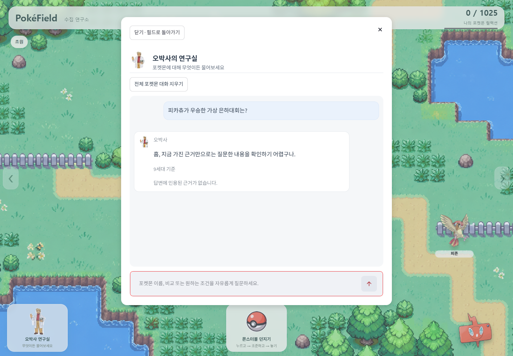

*IMG-06 · F2007·F2008 · 기존 로컬 Chrome / FakeLLM UI. 조건: 인용 근거가 없는 응답. 결과: 무인용 안내 표시 / 실제 GMS 확인 불가 결과는 별도 로그. 일자: 2026-10-23 점검 기록(기존 캡처의 정확한 촬영 시각은 미기록). XLSX: 증빙!B277. 기존 범위 설명: 로컬 Streamlit·FakeLLM의 무인용 안내입니다. 실제 GMS 확인 불가 답변은 원본 로그로만 연결합니다.*

<a id="verify-4-4"></a>

### 4.4 서비스 기능과 화면 확인 (F2009~F2012)

| 확인 항목 | 증빙 연결 상태 | 실제 결과·범위 | 화면·원본 |
|---|---|---|---|
| 항목 변경·기록 분리 | 연결 완료 | 전체/피카츄/라이츄 전환과 재진입 메시지 복원입니다. 로컬 타입 답변·Chrome입니다. | [기록 로그](evidence/logs/game-results.json) · [모바일 크기 화면](evidence/screenshots/game-mobile-chat.png) |
| 조건과 다른 결과 제외 | 연결 완료 | 타입·특성·수치·기술 단위 테스트와 특성/기술 첫·추가 페이지 선택 연결입니다. | [기존 회귀](evidence/logs/current-tests.log) · [브라우저](evidence/logs/browser-results.json) |
| 도메인 결과·근거 | 부분 증빙 | 팬텀 6→7 변화·두 세대 인용은 실제 GMS 로그에 있습니다. 원 UI 캡처는 없고 모순 문구도 남아 있습니다. | [실제 GMS](evidence/logs/gms-live-results-20261023.json) |
| 수집·생성 진행 상태 | 부분 증빙 | 생성 스피너는 FakeLLM UI입니다. 실제 신규 문서 수집의 진행/완료 화면은 없습니다. | [진행 화면](evidence/screenshots/03-progress-FakeLLM-current.png) |
| 색인·API 키 없는 상태 | 연결 완료 | 격리 환경에서 안전한 안내를 확인했습니다. 운영 키/색인은 변경하지 않았습니다. | [키 누락](evidence/screenshots/06-missing-key-current.png) · [색인 누락](evidence/screenshots/06-empty-index-current.png) |
| 위험 도메인 면책 | 해당없음 | 포켓몬 게임 도메인입니다. 건강·금융 의사결정 도메인으로 분류하지 않습니다. | [프로젝트 소개](../README.md) |

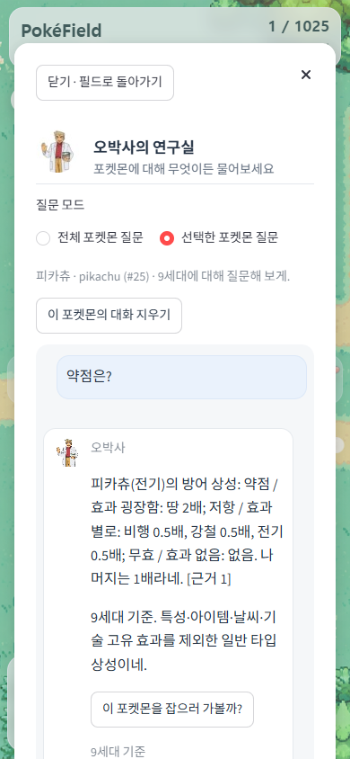

*IMG-07 · F2009 · 기존 로컬 Chrome 모바일 크기 / 로컬 타입 답변. 조건: 선택형 채팅 진입·전체/항목별 전환 로그와 함께 확인. 결과: 선택 문맥·답변 표시 / 단일 화면만으로 기록 분리 전부를 증명하지 않음. 일자: 2026-10-23 점검 기록(기존 캡처의 정확한 촬영 시각은 미기록). XLSX: 증빙!B310. 기존 범위 설명: 실제 로컬 Chrome 모바일 크기·로컬 타입 답변입니다. 단일 화면만으로 전체 기록 격리를 증명하지 않으며 game-results.json의 전환 결과와 함께 봅니다.*

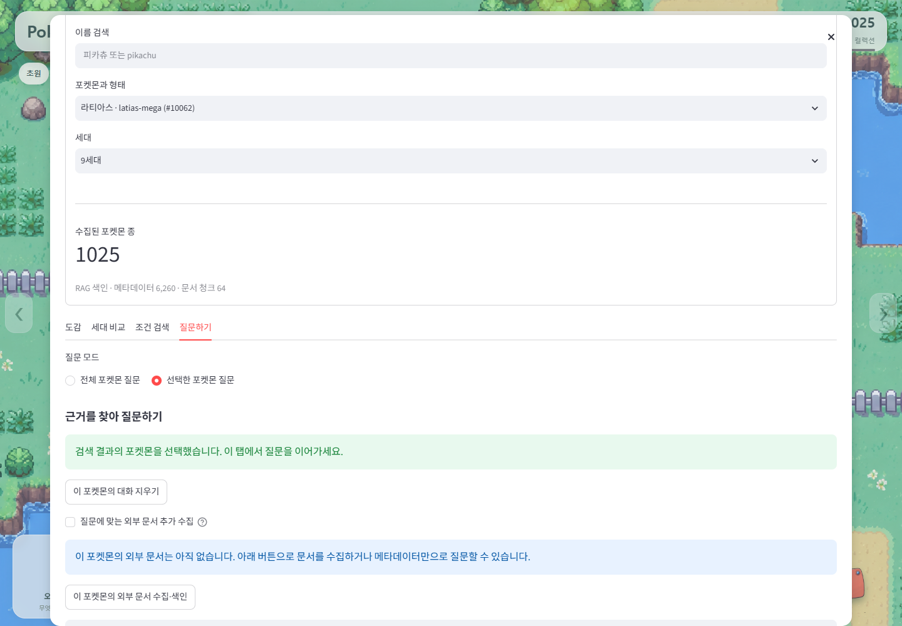

*IMG-08 · F2011 · 기존 로컬 Chrome / 로컬 답변. 조건: 특성 검색 결과에서 포켓몬 선택→질문. 결과: 질문 연결 화면 / 정확한 필터 검증은 단위·브라우저 로그와 함께 확인. 일자: 2026-10-23 점검 기록(기존 캡처의 정확한 촬영 시각은 미기록). XLSX: 증빙!B343. 기존 범위 설명: 실제 로컬 Chrome·선택→질문 화면입니다. 로컬 답변 경로이며 실제 GMS가 아닙니다. 필터 정확성은 회귀 로그를 함께 확인합니다.*

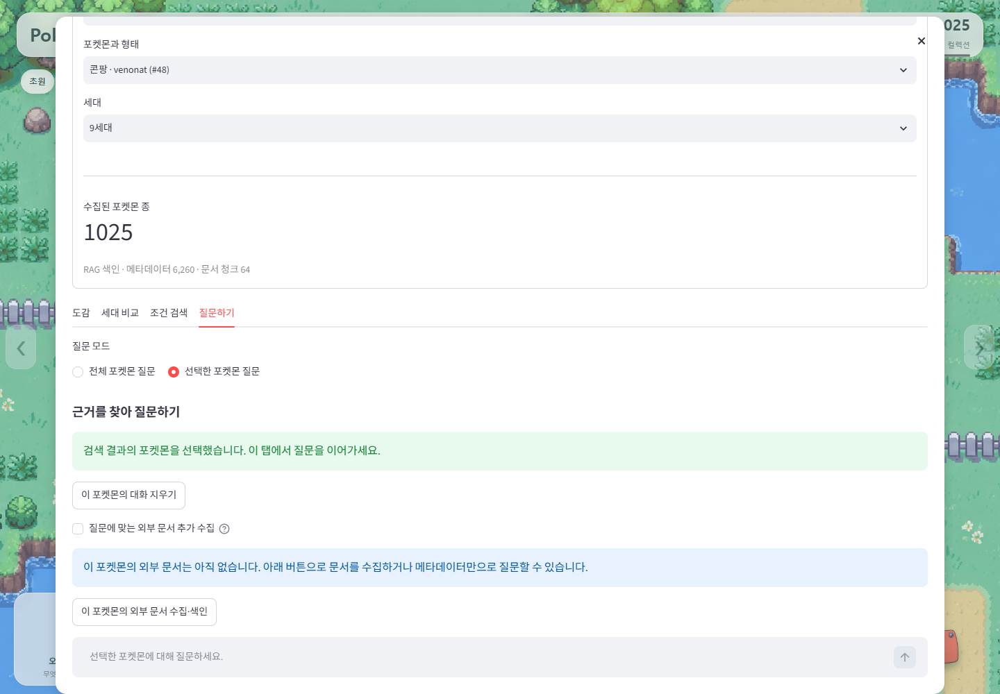

*IMG-09 · F2011 · 기존 로컬 Chrome / 로컬 답변. 조건: 기술 검색 결과에서 선택→질문. 결과: 연결 화면 / 첫·추가 페이지 성공은 별도 브라우저 로그. 일자: 2026-10-23 점검 기록(기존 캡처의 정확한 촬영 시각은 미기록). XLSX: 증빙!B376. 기존 범위 설명: 실제 로컬 Chrome·기술 결과 연결 화면입니다. 첫/추가 페이지 성공은 browser-results.json에 기록됐으며 이 한 장을 두 페이지 각각의 캡처로 간주하지 않습니다.*

F2012 생성 스피너·키 누락·빈 색인은 앞의 화면 증빙 절에 각각 한 번 삽입했습니다. 연결 오류는 [격리 localhost 실패 로그](verification/connection-error-results.json)에서 전체/선택 모드 모두 `actual_local_connection_failure=true`, `safe_notice=true`, `retry_button=true`입니다.

[추가 증빙 필요: 실제 GMS 팬텀 6→7 답변과 두 세대 근거가 한 화면에 보이는 UI입니다. 기존 결과를 인위적으로 재생하여 새 실제 GMS 캡처로 만들지 않습니다. 운영자가 별도 비용 허용 후 세대 비교 화면을 촬영해야 합니다.]

<a id="verify-4-5"></a>

### 4.5 심화 기능 확인 (F2013~F2016)

| 확인 항목 | 증빙 연결 상태 | 실제 결과·범위 | 화면·원본 |
|---|---|---|---|
| F2013 직접 프론트 | 해당없음 | 미선택입니다. 맵/도감 직접 UI만 부분 구현이며 전체 채팅·근거 프론트/서버 분리 완료는 아닙니다. | [현재 상태](requirements.md) |
| F2014 유사도·MMR 비교 | 해당없음 | 미선택·미구현입니다. MMR 비교 결과를 생성하지 않습니다. | [설계](architecture.md) |
| F2015 RAG 전후 응답 | 해당없음 | 미선택·미구현입니다. 기존 GMS 4회는 전후 비교 실험이 아닙니다. | [실제 GMS](evidence/logs/gms-live-results-20261023.json) |
| F2016 외부 출처 종류 | 해당없음 | 미선택·미충족입니다. pokemon_docs는 한국어 Wikipedia 한 출처입니다. meta 유형 구분과 다릅니다. | [백엔드 JSON](evidence/logs/current-backend-results.json) |


<a id="verify-4-6"></a>

### 4.6 RAG 사용 전후 품질 비교

| 확인 항목 | 증빙 연결 상태 | 실제 결과·범위 | 화면·원본 |
|---|---|---|---|
| 대표 질문 5개 이상 | 해당없음 | F2015 미선택이므로 비교용 질문/결과를 새로 작성하지 않습니다. | [심화 상태](requirements.md) |
| 동일 질문 비RAG/RAG 확보 | 해당없음 | 짝을 이룬 응답 기록이 없습니다. 기존 실제 GMS 응답을 비RAG 결과로 재사용하지 않습니다. | [실제 GMS](evidence/logs/gms-live-results-20261023.json) |
| 정확성·근거·모름 비교 | 해당없음 | 미선택입니다. 임의 점수·성능 개선율을 작성하지 않습니다. | [심화 상태](requirements.md) |
| 비교 문서 제출 | 해당없음 | 미선택이므로 전후 비교 문서를 요구사항 충족 자료로 생성하지 않습니다. | [심화 상태](requirements.md) |


<a id="verify-4-7"></a>

### 4.7 비기능 요구사항 확인 (NF2001~NF2007)

| 확인 항목 | 증빙 연결 상태 | 실제 결과·범위 | 화면·원본 |
|---|---|---|---|
| NF2001 처리시간·사용성 | 부분 증빙 | 실제 GMS 2.016~6.031초는 측정됐으나 사용자 사용성 합격·부하/p95는 미확인입니다. | [성능 원문](evidence/logs/nf-audit-results.json) · [실제 GMS](evidence/logs/gms-live-results-20261023.json) |
| NF2002 수집 캐시 | 연결 완료 | 동일 질문의 신규 HTTP/임베딩 0·변경 청크 0입니다. | [백엔드 JSON](evidence/logs/current-backend-results.json) |
| NF2003 제출물 키 잔존 | 부분 증빙 | 기존 보안 검사와 이번 변경 문서의 비밀값 대조는 구분합니다. 최종 제출 폴더 전체 검사는 별도로 필요합니다. | [후속 보안](evidence/logs/current-security.json) · [정리 검사](evidence/logs/cleanup-integrity-security-check.json) |
| NF2004 UI 내부 정보 비노출 | 연결 완료 | PRIVATE_API_KEY/PRIVATE_FULL_PROMPT/PRIVATE_TRACE 예외를 주입한 AppTest입니다. 실제 비밀값을 노출한 시험이 아닙니다. | [기존 회귀](evidence/logs/current-tests.log) |
| NF2005 모듈 분리 | 연결 완료 | 수집·색인·검색·생성·UI의 모듈과 retrieve→generate 구조입니다. | [설계](architecture.md) · [현재 코드](../src) · [기존 회귀](evidence/logs/current-tests.log) |
| NF2006 재시도·간격·식별 | 부분 증빙 | 모의 헤더·429/503·Retry-After 검증만 있습니다. 실제 연락처 적용 전송은 미확인입니다. | [기존 회귀](evidence/logs/current-tests.log) · [NF 결과](NF_VERIFICATION.md) |
| NF2007 출처·이용 조건 | 부분 증빙 | 위키 15개·이미지 자산 15개 조건 기록입니다. 실제 이미지/원작 권리 확보를 증명하지 않습니다. | [출처](SOURCES_AND_LICENSES.md) · [위키 목록](wikipedia_sources.json) · [자산 목록](asset_provenance.json) |

| 원본 측정·검사 | 기록 값 | 해석 범위 |
|---|---|---|
| GMS 특성 / 진화 / 세대 비교 / 근거 없는 질문 | 5.266 / 6.031 / 5.062 / 2.016초 | 기존 실제 생성입니다. 신규 측정이 아닙니다. |
| 로컬 약점 / 기술 | 중앙값 0.141 / 0.328초 | 각 3회 로컬 Python입니다. |
| 응답 캐시 비교 | cached=true, 신규 HTTP 0 | 0.000초 표시는 반올림이며 모델 생성 속도가 아닙니다. |
| 기존 정보 비노출 검사 | 키·전문·trace 표식 주입 AppTest | 외부 실제 장애·최종 제출 전체 비노출을 자동 보장하지 않습니다. |

[추가 증빙 필요: NF2001은 실제 사용자의 대기시간 사용성 의견입니다. NF2006은 운영자의 실제 연락처 적용 후 단일 정상 요청의 식별자 적용·응답 기록입니다. NF2007은 미확인 이미지/원작 콘텐츠 이용 허락입니다. 연락처·권리·사용자 의견을 임의 작성하지 않습니다.]

<a id="verify-4-8"></a>

### 4.8 제출 전 점검 목록

| 확인 항목 | 증빙 연결 상태 | 실제 결과·범위 | 화면·원본 |
|---|---|---|---|
| 필수 F2001~F2012 전체 동작 | 부분 증빙 | 기록된 실행 범위의 12/12입니다. Cloud 개인 저장 적용·신규 실수집·전체 실유료 UI를 통과로 확장하지 않습니다. | [요구사항 대조표](requirements.md) · [기존 회귀](evidence/logs/current-tests.log) |
| 선택 심화 동작·필수와 비교 | 해당없음 | 심화 미선택입니다. 부분 코드를 선택 과제 완료로 표시하지 않습니다. | [4.5](#verify-4-5) · [4.6](#verify-4-6) |
| 스크린샷 전체 첨부 | 부분 증빙 | 존재하는 관련 앱 화면 19개와 체크리스트 캡처 3개를 본문에 각 한 번 배치했습니다. 로그 시각화 1개는 원본 링크로 보존합니다. 신규 수집·실제 GMS 비교 UI는 미확보입니다. | [캡처 목록](#capture-inventory) |
| 정의서·설계·소스·README | 연결 완료 | 현재 프로젝트에 파일이 있습니다. 제출 최종 업로드 완료를 의미하지 않습니다. | [정의서](requirements.md) · [설계](architecture.md) · [소스](../src) · [README](../README.md) |
| 대조표·결과표·셀프/상호 | 부분 증빙 | 대조표·테스트·공식 셀프 XLSX는 있습니다. 상호는 빈 양식뿐이며 실제 다른 교육생 결과가 없습니다. | [셀프 XLSX](evidence/checklists/Pokefield_셀프점검결과_20261023.xlsx) · [상호 빈 양식](evidence/checklists/상호체크리스트_빈양식.md) |

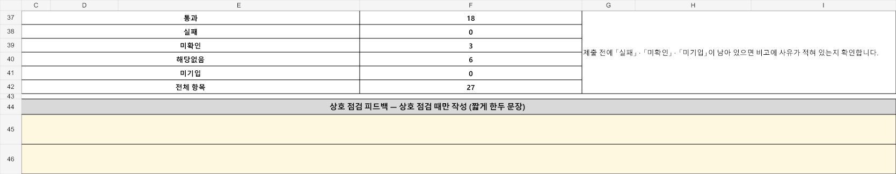

*기존 공식 셀프 XLSX 집계 캡처입니다. 통과 18·실패 0·미확인 3·해당없음 6을 그대로 보존합니다.*

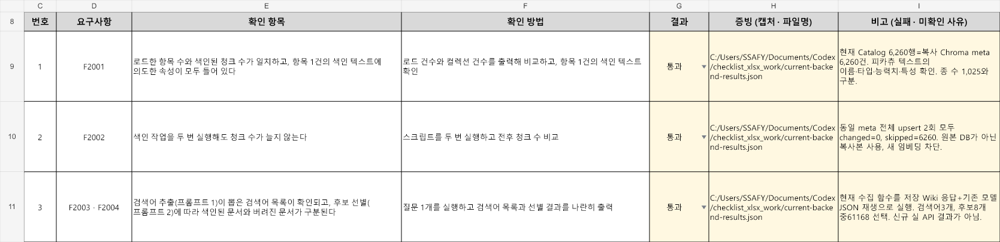

*기존 체크리스트 앞부분 캡처입니다. 기존 G/H/I와 판정의 이력이며 이번 편집으로 미확인을 통과로 바꾸지 않았습니다.*

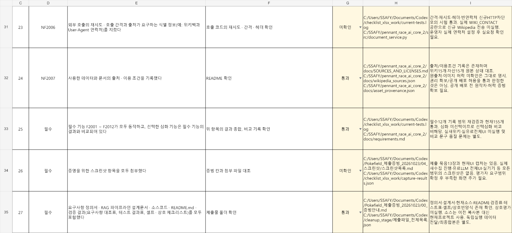

*기존 체크리스트 뒷부분 캡처입니다. 상호 평가 결과가 아니며 실제 작성자 확인이 필요합니다.*

[추가 증빙 필요: 다른 교육생이 실제 앱을 점검한 공식 상호 체크리스트 파일·의견·캡처입니다. 사용자 본인이나 AI가 대신 작성하지 않습니다.]


<a id="capture-inventory"></a>

## 기존 캡처 재사용 목록 및 보조 서비스 화면

이 목록은 선행 편집에서 새 캡처 없이 연결한 기존 앱 화면 19개·공식 셀프 캡처 3개입니다. 이번 최신 재점검은 위에 별도로 실제 브라우저 화면 5개와 XLSX 렌더 미리보기 4개를 추가했습니다. 아래 목록의 ‘기존’은 이번 작업에서 새로 촬영했다는 뜻이 아닙니다. 장면이 비슷한 Cloud A/B는 서로 독립 프로필의 실제 증거라 각각 유지합니다. 로그 시각화는 앱 화면으로 세지 않습니다.

### 필드·UI 보조 증빙

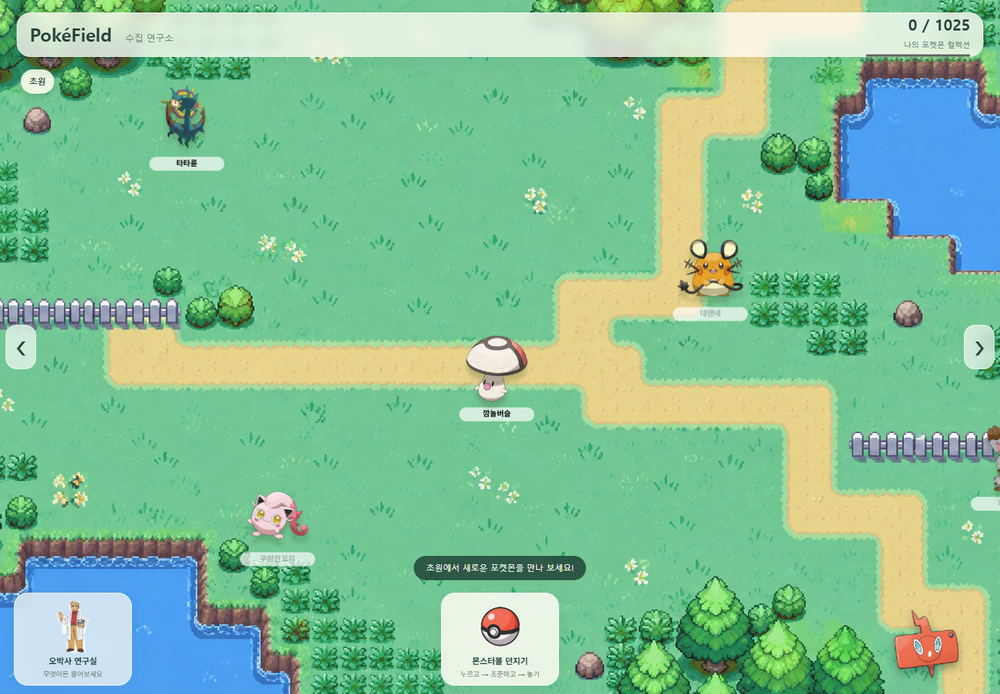

*IMG-18 · 부가 필드 UI · 기존 실제 로컬 Chrome. 조건: PC 필드·지역·메뉴 표시. 결과: 표시 확인 / RAG·색인 성공 증거 아님. 일자: 2026-10-23 점검 기록(기존 캡처의 정확한 촬영 시각은 미기록). XLSX: 증빙!B673. 기존 범위 설명: 실제 로컬 Chrome 필드입니다. RAG 생성 성공 증거가 아닙니다.*

### 도감·항목 조회 보조 증빙

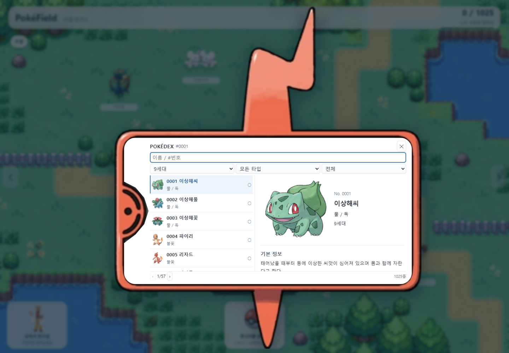

*IMG-19 · 부가 도감 / F2009 선택 UI 참고 · 기존 실제 로컬 Chrome. 조건: 미수집 항목 도감 조회. 결과: 백과사전 정보 표시 / 신규 수집·색인 증거 아님. 일자: 2026-10-23 점검 기록(기존 캡처의 정확한 촬영 시각은 미기록). XLSX: 증빙!B706. 기존 범위 설명: 실제 로컬 Chrome 도감입니다. 미수집 항목의 정보 조회 화면이며 색인 생성 증거가 아닙니다.*

### F2008·F2012 모바일 크기 UI

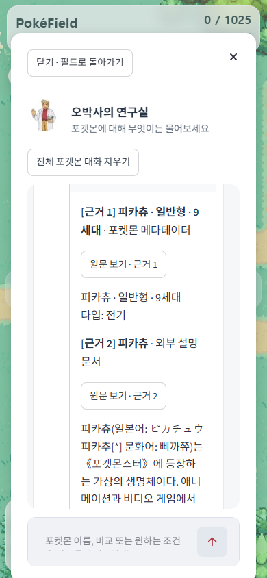

*IMG-20 · F2008·F2012 · 기존 로컬 Chrome 모바일 크기 / FakeLLM. 조건: 채팅·근거의 모바일 크기 표시. 결과: 뷰포트 UI 확인 / 실기기·실제 GMS 검증 아님. 일자: 2026-10-23 점검 기록(기존 캡처의 정확한 촬영 시각은 미기록). XLSX: 증빙!B739. 기존 범위 설명: 로컬 Chrome 모바일 크기·FakeLLM입니다. 모바일 실기기·실제 GMS 검증이 아닙니다.*

### 포획 팝업 보조 증빙

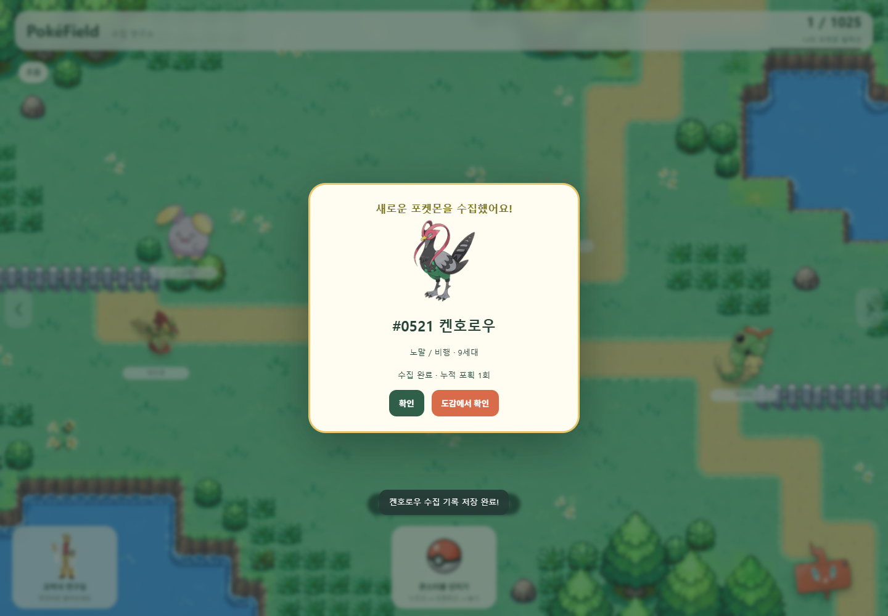

*IMG-21 · 부가 포획 · 기존 실제 로컬 JS / 격리 SQLite. 조건: 과거 포획 성공 팝업. 결과: 팝업 표시 / 현재 localStorage·Cloud 증거 아님. 일자: 2026-10-23 점검 기록(기존 캡처의 정확한 촬영 시각은 미기록). XLSX: 증빙!B772. 기존 범위 설명: 과거 실제 로컬 JS·격리 SQLite 포획입니다. 현재 브라우저 저장이나 Cloud의 증거가 아닙니다.*

### 포획→도감 보조 증빙

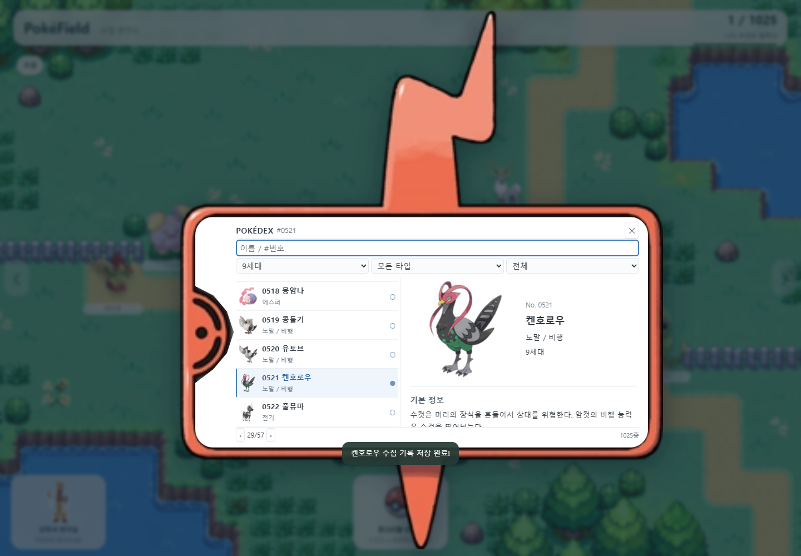

*IMG-22 · 부가 포획→도감 · 기존 실제 로컬 JS / 격리 SQLite. 조건: 과거 포획 후 도감 이동. 결과: 도감 이동 표시 / 현재 브라우저 저장과 구분. 일자: 2026-10-23 점검 기록(기존 캡처의 정확한 촬영 시각은 미기록). XLSX: 증빙!B805. 기존 범위 설명: 과거 실제 로컬 JS·격리 SQLite의 도감 이동입니다. 현재 localStorage 검증과 구분합니다.*

### 현재 브라우저 저장·도감 진입

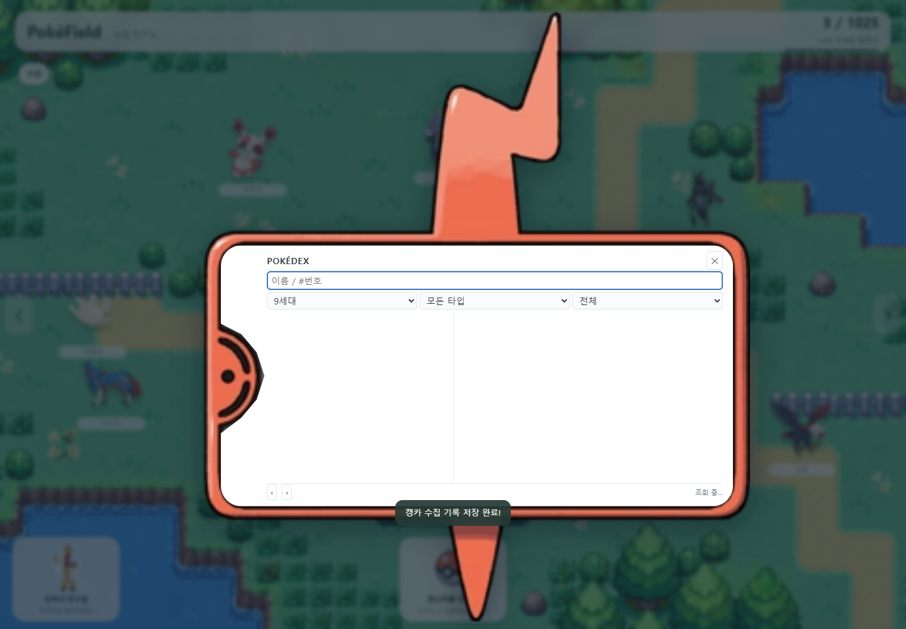

*IMG-24 · 부가 포획→도감 · 선행 실제 로컬 Chrome / localStorage. 조건: 브라우저 저장 보완 당시 팝업→도감. 결과: 도감 진입 장면 / 상세 복원은 로그 확인. 일자: 2026-10-23 점검 기록(기존 캡처의 정확한 촬영 시각은 미기록). XLSX: 증빙!B871. 기존 범위 설명: 실제 로컬 Chrome·브라우저 저장 보완 후 도감 진입 상태입니다. 상세 표시의 증거는 앞의 browser-A-dex.png와 원본 로그를 함께 확인합니다.*

### 저장소 차단·안전한 오류

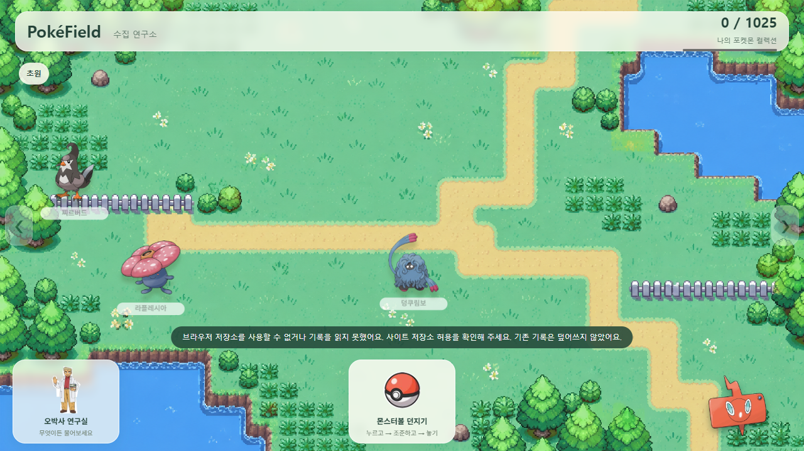

*IMG-25 · 부가 저장 오류 · 선행 실제 로컬 Chrome / 저장소 차단. 조건: 브라우저 저장 보완 당시 차단 시험. 결과: 저장소 차단 안내 / 운영 장애 아님. 일자: 2026-10-23 점검 기록(기존 캡처의 정확한 촬영 시각은 미기록). XLSX: 증빙!B904. 기존 범위 설명: 실제 로컬 Chrome 저장소 접근 차단 안내입니다. 공용 SQLite로 대체하지 않는 동작은 별도 브라우저 로그와 연결합니다.*

### Cloud 독립 프로필 B

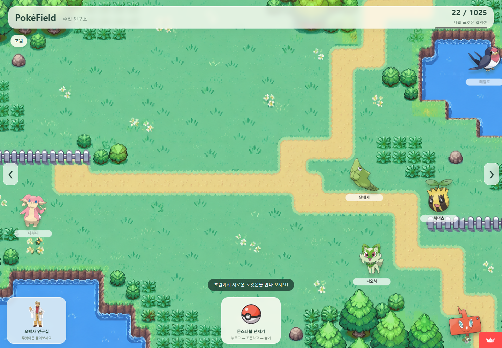

*IMG-27 · 배포 과거 관찰 · 과거 실제 Cloud / 읽기 전용. 조건: 과거 새 B 최초·새로고침, 포획하지 않음. 결과: 22 / 1025 / 현재 상태의 증거로 사용하지 않음. 일자: 2026-10-23 점검 기록(기존 캡처의 정확한 촬영 시각은 미기록). XLSX: 증빙!B970. 기존 범위 설명: 실제 Cloud 읽기 전용 캡처입니다. 새 B에서도 22 / 1025가 표시돼 수정본 적용은 미확인입니다.*

| 기존 파일 | 연결 위치·범위 |
|---|---|
| [04-citations-FakeLLM-current.png](evidence/screenshots/04-citations-FakeLLM-current.png) | 본문에 1회 삽입한 기존 화면이며 각 캡션의 요구사항·환경을 따릅니다. |
| [04b-external-citations-FakeLLM-current.png](evidence/screenshots/04b-external-citations-FakeLLM-current.png) | 본문에 1회 삽입한 기존 화면이며 각 캡션의 요구사항·환경을 따릅니다. |
| [03-progress-FakeLLM-current.png](evidence/screenshots/03-progress-FakeLLM-current.png) | 본문에 1회 삽입한 기존 화면이며 각 캡션의 요구사항·환경을 따릅니다. |
| [06-missing-key-current.png](evidence/screenshots/06-missing-key-current.png) | 본문에 1회 삽입한 기존 화면이며 각 캡션의 요구사항·환경을 따릅니다. |
| [06-empty-index-current.png](evidence/screenshots/06-empty-index-current.png) | 본문에 1회 삽입한 기존 화면이며 각 캡션의 요구사항·환경을 따릅니다. |
| [browser-A-dex.png](evidence/screenshots/browser-A-dex.png) | 본문에 1회 삽입한 기존 화면이며 각 캡션의 요구사항·환경을 따릅니다. |
| [cloud-A.png](evidence/screenshots/cloud-A.png) | 본문에 1회 삽입한 기존 화면이며 각 캡션의 요구사항·환경을 따릅니다. |
| [07-no-evidence-FakeLLM-current.png](evidence/screenshots/07-no-evidence-FakeLLM-current.png) | 본문에 1회 삽입한 기존 화면이며 각 캡션의 요구사항·환경을 따릅니다. |
| [game-mobile-chat.png](evidence/screenshots/game-mobile-chat.png) | 본문에 1회 삽입한 기존 화면이며 각 캡션의 요구사항·환경을 따릅니다. |
| [ability-chat.png](evidence/screenshots/ability-chat.png) | 본문에 1회 삽입한 기존 화면이며 각 캡션의 요구사항·환경을 따릅니다. |
| [moves-chat.png](evidence/screenshots/moves-chat.png) | 본문에 1회 삽입한 기존 화면이며 각 캡션의 요구사항·환경을 따릅니다. |
| [final-summary.png](evidence/checklists/final-summary.png) | 본문에 1회 삽입한 기존 화면이며 각 캡션의 요구사항·환경을 따릅니다. |
| [final-top.png](evidence/checklists/final-top.png) | 본문에 1회 삽입한 기존 화면이며 각 캡션의 요구사항·환경을 따릅니다. |
| [final-last.png](evidence/checklists/final-last.png) | 본문에 1회 삽입한 기존 화면이며 각 캡션의 요구사항·환경을 따릅니다. |
| [01-field-desktop-current.png](evidence/screenshots/01-field-desktop-current.png) | 본문에 1회 삽입한 기존 화면이며 각 캡션의 요구사항·환경을 따릅니다. |
| [02-dex-current.png](evidence/screenshots/02-dex-current.png) | 본문에 1회 삽입한 기존 화면이며 각 캡션의 요구사항·환경을 따릅니다. |
| [05-mobile-FakeLLM-current.png](evidence/screenshots/05-mobile-FakeLLM-current.png) | 본문에 1회 삽입한 기존 화면이며 각 캡션의 요구사항·환경을 따릅니다. |
| [capture.png](evidence/screenshots/capture.png) | 본문에 1회 삽입한 기존 화면이며 각 캡션의 요구사항·환경을 따릅니다. |
| [captured-dex.png](evidence/screenshots/captured-dex.png) | 본문에 1회 삽입한 기존 화면이며 각 캡션의 요구사항·환경을 따릅니다. |
| [browser-A-field-dex.png](evidence/screenshots/browser-A-field-dex.png) | 본문에 1회 삽입한 기존 화면이며 각 캡션의 요구사항·환경을 따릅니다. |
| [browser-storage-blocked.png](evidence/screenshots/browser-storage-blocked.png) | 본문에 1회 삽입한 기존 화면이며 각 캡션의 요구사항·환경을 따릅니다. |
| [cloud-B.png](evidence/screenshots/cloud-B.png) | 본문에 1회 삽입한 기존 화면이며 각 캡션의 요구사항·환경을 따릅니다. |
| [08-실제실행로그시각화-UI아님.png](evidence/screenshots/08-실제실행로그시각화-UI아님.png) | 앱 캡처가 아닌 과거 로그 시각화입니다. 본문에서는 같은 원본 값을 읽기 쉬운 표·코드로 제시하고 중복 삽입하지 않습니다. |

<a id="remaining-evidence"></a>

## 미확보 증빙의 재현·확보 방법

아래는 사용자가 수행할 **남은 작업**이며 실행 결과가 아닙니다. 경로는 촬영 후 사용할 예정 이름이므로 현재 파일 링크로 만들지 않습니다. 심화 미선택 실험은 추가 작업에 포함하지 않습니다.

| 우선순위·항목 | 재현·확보 방법 | 저장 예정 위치·주의사항 |
|---|---|---|
| 필수 보완: 4.2·4.4·NF2006 실제 문서 수집 | 운영자의 실제 영문 연락처를 WIKI_CONTACT에 설정하고 격리 환경에서 피카츄를 선택합니다. 외부 문서 수집·색인 버튼의 진행/완료와 자체 문서 출처를 함께 기록합니다. 기존 캐시만 사용했다면 신규 수집으로 표시하지 않습니다. | `docs/evidence/screenshots/pending-live-wiki-collection.png` 및 요청 상태 로그입니다. 별도 API 비용 허용·운영 연락처 확인이 선행되어야 합니다. 키·연락처 원문은 촬영하지 않습니다. |
| 필수 보완: 4.4 F2010 실제 GMS 비교 UI | 팬텀을 선택하고 세대 비교에서 6→7을 지정한 뒤 AI 변화 분석을 실행합니다. 답변과 두 세대 출처를 펼쳐 촬영합니다. 캐시 응답이면 캐시라고 표시하고 실제 새 생성으로 기록하지 않습니다. | `docs/evidence/screenshots/pending-gms-gengar-6-7.png`입니다. 기존 모순 문구는 숨기거나 편집하지 않습니다. 이번에는 유료 호출하지 않았습니다. |
| 사용자 확인: 4.7 NF2001 | 기존 4개 GMS 응답시간을 바탕으로 실제 사용자가 대기시간의 사용 지장 여부와 점검 날짜·환경을 기록합니다. 새로운 부하/속도 수치를 임의 생성하지 않습니다. | 사용자 점검 의견 파일입니다. 부하·p95 측정은 별도 선택 검증이며 미측정 상태입니다. |
| 사용자 확인: 4.7 NF2007 | 이미지 원게시 페이지·적용 조건 또는 실제 권리자의 허락을 확보합니다. API 사용 가능성과 캐릭터 콘텐츠 배포 권한을 구분합니다. | 출처별 실제 허락·라이선스 증빙입니다. 미확인 권리를 통과로 바꾸지 않습니다. |
| 필수 보완: 4.8 상호 점검 | 다른 교육생이 실제 앱을 점검하고 공식 XLSX의 상호 영역에 결과·의견을 작성합니다. 작성한 파일과 해당 영역을 촬영해 함께 제출합니다. | `docs/evidence/checklists/`에 실제 작성 파일·화면을 보관합니다. 기존 셀프 원본과 빈 양식은 보존합니다. |
| 배포 별도 확인: Cloud 개인 저장 | Cloud 관리 화면의 배포 커밋을 확인한 뒤 새 프로필 A/B가 각 0에서 시작하고 독립 포획·새로고침·도감 반영을 유지하는지 확인합니다. | 기존 cloud-A/B는 22건 표시를 기록한 과거 증거입니다. 수정본 성공 화면으로 재사용하지 않습니다. |

선행 공식 셀프 26번은 미확인이었으나 이번 전수 대조에서 누락을 확인해 실패로 재판정했습니다. 미확보 화면과 실제 제출 범위의 보완이 필요합니다. 선행 문서 작성에서는 XLSX를 변경하지 않았으며 최신 재점검의 실제 변경 판정은 최신 셀프 절을 따릅니다.
