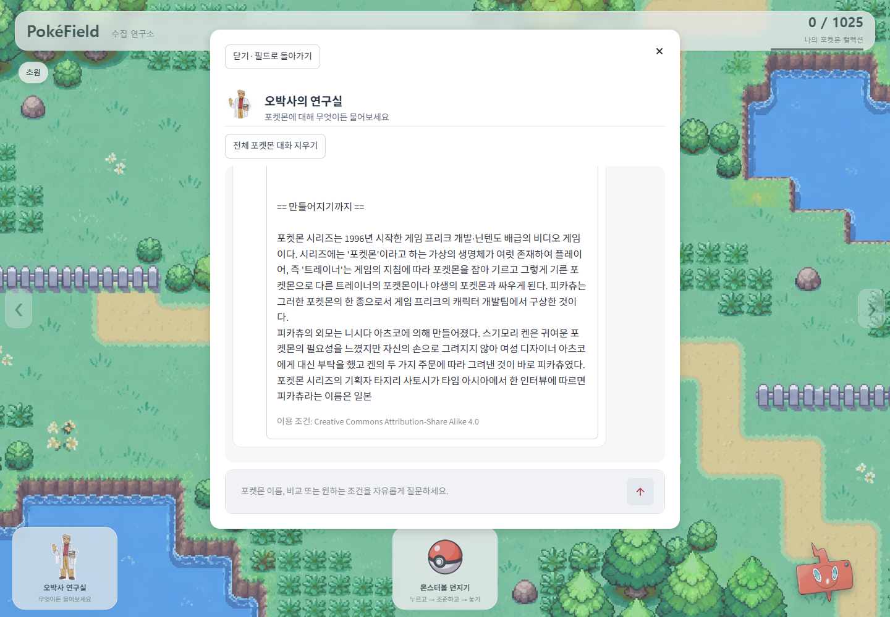
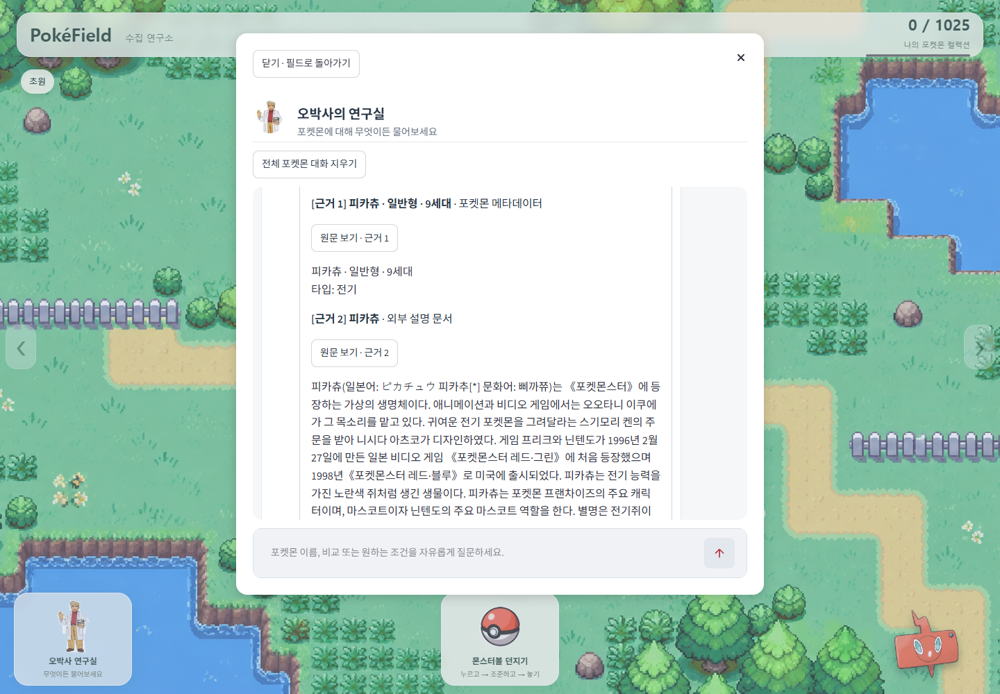
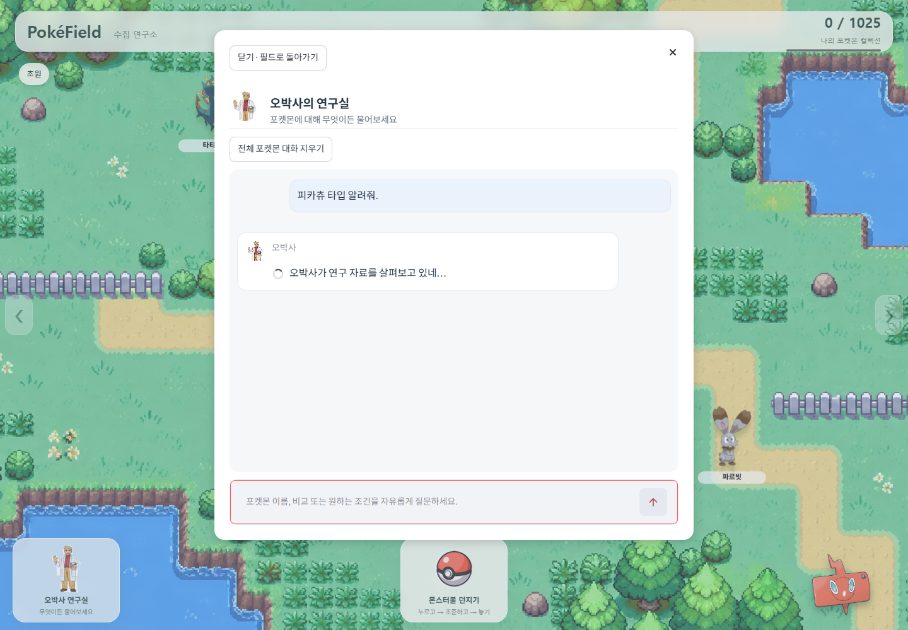
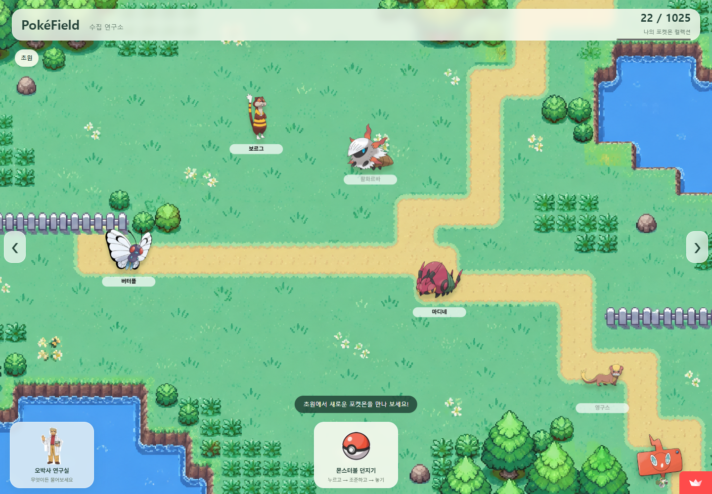

# PokéField 검증 결과

기준일은 2026-10-23입니다. 요구사항 정의서 4장·6장과 공식 셀프 점검 27항목을 기준으로 기존 실행 결과를 정리합니다. **기존 실행 이력을 보존하고 브라우저 저장 관련 8개 테스트·Cloud 읽기 검사를 추가했습니다. GMS 호출·재색인은 수행하지 않았습니다.**

## 1. 판정과 실행 이력

필수 F2001~F2012는 기록된 실행 범위에서 12/12입니다. 알려진 답변 품질 문제와 미실행 범위까지 통과했다는 뜻은 아닙니다. 심화 F2013~F2016은 **미선택**입니다.

| 실행 | 테스트 수·결과 | 시간 | 환경·범위 |
|---|---|---|---|
| 선행 NF 보완 회귀 | 155/155 통과 | 46.241초 | 기존 147개 + NF 8개입니다. 임시 DB·모의 HTTP·FakeLLM을 사용했습니다. |
| 후속 공식 체크리스트 회귀 | 155/155 통과 | 47.379초 | 실패·오류·건너뜀 0입니다. 격리 저장소·FakeLLM/FakeEmbeddings이며 유료 API를 차단했습니다. |

선행 [NF 기록](evidence/logs/nf-audit-results.json), 후속 [전체 로그](evidence/logs/current-tests.log)·[집계](evidence/logs/unit-summary.json)를 연결합니다. 두 실행을 합산하지 않습니다.

### 실제 GMS·로컬·캐시 결과

| 질문/검사 | 실행 종류 | 결과 | 시간 |
|---|---|---|---|
| 피카츄 특성 | 실제 GMS | 일반 정전기·숨겨진 피뢰침, 근거 1입니다. | 5.266초 |
| 피카츄 진화 | 실제 GMS | 라이츄와 진화 근거를 인용합니다. | 6.031초 |
| 팬텀 6→7 비교 | 실제 GMS | 부유→저주받은바디, 근거 2/1입니다. 모순된 확인 불가 문구가 붙는 **품질 실패**는 남아 있습니다. | 5.062초 |
| 2099년 가상 대회 도시 | 실제 GMS | 확인 불가로 답하며 도시를 생성하지 않았습니다. | 2.016초 |
| 피카츄 약점 | 로컬 Python | 땅 2배·일반 상성 기준입니다. | 0.125초 |
| 몸통박치기 검색 | 로컬 Python | 9세대 247마리, 첫 6마리와 버전/방법입니다. | 0.938초 |
| 반복 세대 비교 | 앱 응답 캐시 | cached=True·추가 HTTP 0입니다. | 0.000초, 반올림 |

실제 모델은 GMS `gpt-6.1-sol`이며 생성 **4회·입력 14,413·출력 252·총 14,665토큰**입니다. 추가 임베딩 HTTP는 0회입니다. [원본 실제 결과](evidence/logs/gms-live-results-20261023.json)를 제공합니다. 약점·기술·캐시는 실제 모델 호출 수에 넣지 않습니다.

### 브라우저·게임 이력

| 검사 | 결과와 범위 | 시간 |
|---|---|---|
| 조건 검색→선택→질문 | Chrome에서 특성·기술 첫/추가 페이지를 확인했습니다. | 개별 미기록 |
| 대화 기록 분리 | 전체·피카츄·라이츄 전환과 재진입 복원입니다. | 개별 미기록 |
| 선행 포획→도감 | 달코퀸 #0763, 실제 JS·격리 SQLite입니다. | 7.649초 |
| 후속 포획→도감 | 켄호로우 #0521, 실제 JS·격리 SQLite입니다. | 7.059초 |
| 연결 오류 | 실제 localhost 연결 거부와 AppTest의 안전한 안내·재시도입니다. | 개별 미기록 |
| PC/모바일 크기 | 1440×1000 / 390×844, 검사 범위 JS 예외·console.error 0입니다. | 개별 미기록 |

[후속 브라우저](evidence/logs/browser-results.json), [후속 게임·기록](evidence/logs/game-results.json), [선행 포획](verification/capture-history-results.json), [연결 오류](verification/connection-error-results.json)를 연결합니다. 브라우저 래퍼에는 FakeLLM이 장착됐지만 해당 검색·게임·기록 검사는 로컬 답변과 실제 JS/SQLite 경로입니다. 실유료 모델의 전체 UI 시연이나 모바일 실기기 시험은 아닙니다.

부가 서비스는 [PC 필드](evidence/screenshots/01-field-desktop-current.png), [도감](evidence/screenshots/02-dex-current.png), [포획→도감](evidence/screenshots/captured-dex.png) 원본으로 제공합니다. 캡처 대상은 함께 동봉한 game-results.json을 따릅니다.

## 2. 데이터·수집·색인 검증

다음은 [기존 백엔드 JSON](evidence/logs/current-backend-results.json)의 결과입니다. 긴 로그는 [원본 로그 시각화](evidence/screenshots/08-실제실행로그시각화-UI아님.png)로 보존하며 작은 이미지를 본문에 축소 삽입하지 않습니다. 로그 시각화는 앱 화면이 아닙니다.

| 요구사항 | 확인 결과 | 실행 범위 |
|---|---|---|
| F2001 | Catalog 6,260행 = meta 6,260건입니다. 1,025종·1,351형태와 구분합니다. | 실제 데이터와 복사 Chroma입니다. |
| F2001 | 피카츄 표본의 이름·타입·능력치·일반/숨겨진 특성을 확인했습니다. | 원문은 JSON의 sample_metadata입니다. |
| F2002 | meta upsert 두 번 모두 changed=0·skipped=6260·count=6260입니다. | 복사 DB이며 새 임베딩을 차단했습니다. |
| F2003 | 피카츄 / 피카츄 진화 / 피카츄 세대별 특징, 검색어 3개입니다. | 저장 Wikipedia 응답·과거 모델 JSON 재생입니다. |
| F2004 | 후보 8개 중 61168을 선택하고 종 자체 문서를 포함했습니다. | 신규 실수집이 아닙니다. |
| F2005 | docs 64청크이며 15개 문서-종 연결/10종 범위입니다. | 기존 저장 색인입니다. |
| F2005 | 1000/200→18, 500/100→36, 200/20→79청크입니다. | 동일 피카츄 문서·격리 DB·FakeEmbeddings입니다. 운영 전체 64개와 범위가 다릅니다. |
| NF2002 | 동일 질문 두 번 신규 HTTP/임베딩 0·변경 청크 0입니다. | 캐시 재사용입니다. |
| F2006 | k=1/3/5 → 필수 meta 포함 근거 2/4/6개, ID 중복 0입니다. | 복사 색인·질의 임베딩 캐시입니다. |
| F2007 | START→retrieve→generate→END입니다. | 기존 실제 그래프 구조 출력입니다. |

후보 ID는 61168·1641079·14779·857467·558873·2514891·35277·188035입니다. 선택되지 않은 ID는 candidate_ids와 selected_ids의 차집합으로 확인합니다. rejected 필드가 비었다고 모든 후보가 색인됐다는 뜻은 아닙니다. 청킹 실험은 청크 수 변화만 확인했으며 품질·비용·지연의 최적값 실험은 아닙니다.

[추가 증빙 필요: 실제 운영 연락처를 적용한 신규 Wikipedia 수집 진행·완료 화면입니다. 신규 실제 수집 성공으로 판정하지 않습니다.]

## 화면 증빙

### F2008 답변·인용·출처

아래 두 화면은 답변 번호와 대응하는 메타/외부 유형·제목·원문 링크를 함께 확인하는 기존 **FakeLLM UI**입니다. 실제 GMS 인용 검증 4사례는 별도 원본 JSON입니다.

*F2008 답변 본문 화면입니다. FakeLLM이며 원본 이미지를 클릭해 확대할 수 있습니다.*

*F2008 대응 근거 화면입니다. FakeLLM이며 실제 유료 생성 화면이 아닙니다.*

### F2007·F2009·F2010·F2011

| 항목 | 읽을 수 있는 원본 화면·로그 | 범위 |
|---|---|---|
| 근거 없음 | [무인용 UI](evidence/screenshots/07-no-evidence-FakeLLM-current.png), [실제 GMS](evidence/logs/gms-live-results-20261023.json) | FakeLLM UI와 실제 확인 불가 답변 로그를 구분합니다. |
| 기록 분리 | [선택형 모바일 화면](evidence/screenshots/game-mobile-chat.png), [기록 로그](evidence/logs/game-results.json) | 로컬 답변·Chrome 화면 크기 모의입니다. |
| 특성 검색 연결 | [선택→질문 화면](evidence/screenshots/ability-chat.png), [브라우저 로그](evidence/logs/browser-results.json) | 실제 Chrome·로컬 답변입니다. |
| 기술 검색 연결 | [기술 결과 화면](evidence/screenshots/moves-chat.png), [첫/추가 페이지 로그](evidence/logs/browser-results.json) | 첫·추가 페이지 모두 기존 검증입니다. |
| 세대 비교 | [실제 GMS 결과](evidence/logs/gms-live-results-20261023.json), [155개 회귀](evidence/logs/current-tests.log) | 변경 계산·두 세대 인용은 확인됐지만 모순 문구는 미해결입니다. |

[추가 증빙 필요: 실제 GMS 팬텀 6→7 답변과 두 세대 근거가 함께 보이는 원래 UI 화면입니다. 로그만 존재하며 재현 화면을 실제 결과로 만들지 않았습니다.]

### F2012 진행·오류 안내

*기존 FakeLLM 생성 스피너입니다. 실제 GMS의 지연시간·토큰 증거가 아닙니다.*

[API 키 누락 화면](evidence/screenshots/06-missing-key-current.png)과 [색인 누락 화면](evidence/screenshots/06-empty-index-current.png)은 원본 크기로 확인할 수 있습니다. 격리 환경이며 운영 키·색인을 삭제하지 않았습니다. 연결 오류는 [localhost 실제 연결 거부와 AppTest](verification/connection-error-results.json)의 범위입니다. 실제 외부 401/429/5xx 장애를 재현한 것은 아닙니다.

## 3. 공식 셀프 체크리스트

[원본과 동일한 공식 XLSX 사본](evidence/checklists/Pokefield_셀프점검결과_20261023.xlsx)의 G/H/I·수식·상호 빈 영역은 변경하지 않았습니다.

| 통과 | 실패 | 미확인 | 해당없음 | 전체 |
|---|---|---|---|---|
| 18 | 0 | 3 | 6 | 27 |

미확인은 20번 NF2001, 23번 NF2006, 26번 전체 스크린샷 첨부입니다. 14번 위험 도메인과 15~19번 미선택 심화는 해당없음입니다. 아래는 기존 판정·비고의 가독성 편집이며 상세 원문은 [27항목 원문](evidence/logs/assessments.json)에 보존합니다. 원래 H열의 Windows 경로는 [제출용 상대경로 대조표](evidence/path-map.json)로 확인합니다.

### 1~7번: 데이터·수집·색인·그래프

| 번호 | 기존 판정 | 확인 내용과 한계 | 증빙 |
|---|---|---|---|
| 1 | 통과 | 6,260행과 meta 6,260건 일치, 피카츄 색인 속성 확인입니다. | [원문](evidence/logs/current-backend-results.json) |
| 2 | 통과 | 복사 DB에서 두 번 모두 changed=0·skipped=6260입니다. | [원문](evidence/logs/current-backend-results.json) |
| 3 | 통과 | 검색어 3개·후보 8개 중 61168 선택입니다. 저장 응답/모델 JSON 재생입니다. | [원문](evidence/logs/current-backend-results.json) |
| 4 | 통과 | 반복 수집의 신규 HTTP/임베딩·변경 청크가 모두 0입니다. | [원문](evidence/logs/current-backend-results.json) |
| 5 | 통과 | 1000/200·500/100·200/20에서 18/36/79개입니다. FakeEmbeddings입니다. | [원문](evidence/logs/current-backend-results.json) |
| 6 | 통과 | k=1/3/5에서 필수 meta 포함 2/4/6개, ID 중복 없음입니다. | [원문](evidence/logs/current-backend-results.json) |
| 7 | 통과 | 실행 그래프는 START→retrieve→generate→END입니다. | [원문](evidence/logs/current-backend-results.json) |

### 8~13번: 답변·서비스

| 번호 | 기존 판정 | 확인 내용과 한계 | 증빙 |
|---|---|---|---|
| 8 | 통과 | 번호·유형·제목·링크 UI는 FakeLLM입니다. 실제 GMS 인용 4사례와 구분합니다. | [근거](evidence/screenshots/04b-external-citations-FakeLLM-current.png) |
| 9 | 통과 | 실제 GMS의 확인 불가 답변과 별도 FakeLLM 무인용 안내입니다. | [근거1](evidence/logs/gms-live-results-20261023.json) · [근거2](evidence/screenshots/07-no-evidence-FakeLLM-current.png) |
| 10 | 통과 | 전체→피카츄→라이츄→피카츄 전환, 개별 메시지 2개 복원입니다. | [근거1](evidence/logs/game-results.json) · [근거2](evidence/screenshots/game-mobile-chat.png) |
| 11 | 통과 | 타입·특성·능력치·기술 회귀와 검색 첫/추가 페이지 질문 연결입니다. | [근거1](evidence/logs/current-tests.log) · [근거2](evidence/logs/browser-results.json) |
| 12 | 통과 | 팬텀 6→7 변경·인용 기능은 확인됐고 모순된 확인 불가 문구는 미해결입니다. | [근거1](evidence/logs/gms-live-results-20261023.json) · [근거2](evidence/logs/current-tests.log) |
| 13 | 통과 | 생성 스피너·키/빈 색인 안내는 격리 UI입니다. 실제 신규 수집 진행은 미실행입니다. | [근거1](evidence/screenshots/03-progress-FakeLLM-current.png) · [근거2](evidence/screenshots/06-missing-key-current.png) · [근거3](evidence/screenshots/06-empty-index-current.png) |

### 14~19번: 비해당·미선택

| 번호 | 기존 판정 | 확인 내용과 한계 | 증빙 |
|---|---|---|---|
| 14 | 해당없음 | 포켓몬 게임 도메인으로 건강·금융 면책 항목 비해당입니다. | [근거](../README.md) |
| 15 | 해당없음 | 심화 미선택입니다. 맵/도감 직접 UI는 F2013 부분 구현입니다. | [근거](../src/ui_rag.py) |
| 16 | 해당없음 | 심화 미선택입니다. MMR 경로·대조 실행은 없습니다. | [근거](evidence/logs/current-backend-results.json) |
| 17 | 해당없음 | 심화 미선택입니다. 동일 5문항 비RAG/RAG 비교는 없습니다. | [근거](requirements.md) |
| 18 | 해당없음 | 심화 미선택입니다. 전후 비교 제출 문서는 없습니다. | [근거](VERIFICATION_SUMMARY.md) |
| 19 | 해당없음 | 심화 미선택입니다. meta/외부 유형 구분은 다중 외부 출처 결합이 아닙니다. | [근거](evidence/logs/current-backend-results.json) |

### 20~27번: 비기능·제출 준비

| 번호 | 기존 판정 | 확인 내용과 한계 | 증빙 |
|---|---|---|---|
| 20 | 미확인 | 응답시간 기록은 있으나 사용성 합격은 미판정입니다. 부하·p95는 미측정입니다. | [근거1](evidence/logs/current-backend-results.json) · [근거2](evidence/logs/nf-audit-results.json) |
| 21 | 통과 | 기존 비노출 AppTest와 보안 검사를 통과했습니다. 최종 제출 폴더는 별도 검사 대상입니다. | [근거1](evidence/logs/current-tests.log) · [근거2](evidence/logs/cleanup-integrity-security-check.json) |
| 22 | 통과 | 데이터·수집·색인·검색·생성·UI 모듈과 그래프·회귀 경로를 확인했습니다. | [근거1](../src) · [근거2](evidence/logs/current-backend-results.json) |
| 23 | 미확인 | 헤더·간격·재시도 모의 시험은 통과했으나 실제 연락처 전송은 미실행입니다. | [근거1](evidence/logs/current-tests.log) · [근거2](../src/document_service.py) |
| 24 | 통과 | 위키 15개·자산 15개 출처/조건 기록입니다. 실제 권리 확보 통과는 아닙니다. | [근거1](SOURCES_AND_LICENSES.md) · [근거2](wikipedia_sources.json) · [근거3](asset_provenance.json) |
| 25 | 통과 | 필수 12개는 기록된 범위의 판정입니다. 신규 실위키·전체 실유료 UI는 미실행입니다. | [근거1](evidence/logs/current-tests.log) · [근거2](requirements.md) |
| 26 | 미확인 | 기존 캡처는 있으나 필요한 전체 범위의 첨부 완료는 미확인입니다. | [근거1](evidence/logs/스크린샷목록.txt) · [근거2](evidence/logs/capture-results.json) |
| 27 | 통과 | 기존 자료 존재 확인 범위입니다. 상호 빈 양식은 실제 결과가 아니며 제출 전체 완료가 아닙니다. | [근거1](evidence/logs/기존증빙안내.txt) · [근거2](evidence/logs/기존제출파일목록.json) |

셀프 작성자 C4는 비어 있고 점검자 C5는 AI QA입니다. 실제 사람이 점검하거나 서명한 것으로 표시하지 않습니다. 작은 엑셀 미리보기는 본문에서 제외하고 [집계 원본](evidence/checklists/final-summary.png), [앞부분 원본](evidence/checklists/final-top.png), [뒷부분 원본](evidence/checklists/final-last.png)을 연결합니다.

### 상호 점검

[빈 양식](evidence/checklists/상호체크리스트_빈양식.md)만 준비되어 있습니다. 다른 교육생의 실제 결과·의견·서명은 없으므로 제출 완료로 표시하지 않습니다.

[추가 증빙 필요: 다른 교육생이 실제 앱을 점검하고 공식 양식에 작성한 상호 결과·의견 화면과 파일입니다.]

## 4. 비기능·제출 전 확인

[NF2001~NF2007 판정과 측정](NF_VERIFICATION.md), [출처·이용 조건](SOURCES_AND_LICENSES.md)을 연결합니다. NF2001·NF2006·NF2007은 확인 필요를 유지합니다.

| 제출 확인 | 현재 상태·필요 조치 |
|---|---|
| 정의서·설계·현재 소스·README | 현재 프로젝트 자료를 사용합니다. 과거 패키지의 소스 사본과 혼동하지 않습니다. |
| 필수 기능 | 기록된 범위 12/12이며 모든 네트워크·버전·모바일 환경의 완전성을 보장하지 않습니다. |
| 심화 | F2013~F2016 미선택이며 비교 결과를 만들지 않습니다. |
| 테스트·화면·로그 | 기존 증빙 링크를 제공합니다. 이 문서 편집을 새 실행 성공으로 표시하지 않습니다. |
| 셀프 | 공식 XLSX와 판정을 유지합니다. 실제 작성자 확인과 사람의 최종 검토가 필요합니다. |
| 상호 | 실제 다른 교육생의 점검 결과가 필요합니다. |
| 운영·권리 | 사용성 의견, 실제 연락처 전송, 이미지/원작 콘텐츠 허락이 미확인입니다. |
| 최종 전달 | 최종 제출 폴더의 키·개인정보·캐시 제외·라이선스 고지와 경로를 다시 확인해야 합니다. ZIP은 생성하지 않았습니다. |

보안 수치는 선행 NF 95개, 후속 텍스트 112개, 정리 단계 텍스트 156개·조건부 데이터/색인 4,572개로 대상 범위가 다릅니다. [후속 보안](evidence/logs/current-security.json)과 [정리 검사](evidence/logs/cleanup-integrity-security-check.json)를 합산하지 않습니다.

추가 미실행은 외부 API 401/429/5xx 실제 장애, 실기기 모바일, 새 장치 전체 설치, 운영 SLA·동시성·p95입니다. MMR·비RAG 비교는 미선택입니다. 팬텀 답변 모순 문구는 별도 코드 수정이 필요한 상태이며 이번 작업에서는 수정하지 않았습니다.

## 브라우저 포획 저장 및 Cloud 확인 (2026-10-23)

기존 155개 테스트·SQLite 포획 화면·실제 GMS 수치는 과거 실행 이력으로 유지합니다. 아래 검증은 개인별 포획 저장 변경에 관한 별도 결과이며 기존 실제 GMS 4회와 합산하지 않습니다. 이번 작업의 LLM·임베딩·재색인 호출은 0회입니다.

| 검사 | 실행 결과 | 범위·증빙 |
|---|---|---|
| 저장 보완 후 전체 회귀 | 163/163 통과, 45.941초 | 선행 격리 실행입니다. [전체 로그](evidence/logs/browser-storage-unit-tests-isolated.log)입니다. 첫 sandbox 실행의 임시파일 교체 권한 오류 후 격리 환경에서 재실행한 결과이며 API 호출은 없습니다. |
| 이번 관련 회귀 | 8/8 통과 | [현재 실행 로그](evidence/logs/browser-storage-targeted-tests.log)입니다. 전체 163개를 이번 편집에서 다시 실행한 것은 아닙니다. |
| 기존 A/B·복원·도감 | 실제 로컬 Chrome 통과 | 별개 프로필 초기 0·독립 포획·새 Streamlit 세션/새 탭 복원·동일 프로필 탭 동기화·포획→팝업→도감입니다. [로그](evidence/logs/browser-storage-browser-results.json)와 [현재 코드 일치 검사](evidence/logs/browser-storage-source-check.json)를 제공합니다. |
| 저장 실패·멱등·이관 방지 | 모의 ACK 검사 통과 | 실제 생산 JS와 localStorage이며 서버 응답만 모의입니다. [별도 결과](evidence/logs/browser-storage-storage-edge-results.json)입니다. 실제 Cloud backend 검사가 아닙니다. |
| 실제 Cloud 접근 | 필드 표시, JS pageerror 0 | https://pokefield.streamlit.app/ 의 실제 화면입니다. 샌드박스 DNS 제한으로 첫 접근 실패 후 허용된 네트워크에서 접속했습니다. |
| 실제 Cloud A/B 읽기·새로고침 | 현재 개인별 저장 적용 확인 불가 | 두 새 독립 프로필 모두 최초/재접속 `22 / 1025`, `pokefield:` localStorage 키 0개입니다. [Cloud 원본 로그](evidence/logs/cloud-readonly-results.json)입니다. 공유 원천의 종류나 배포 커밋은 UI만으로 단정하지 않습니다. |

개별 브라우저 동작의 응답 시간은 기록되지 않아 수치를 추가하지 않습니다. Cloud에서는 운영 데이터 보존을 위해 포획·채팅·수집·색인 작업을 수행하지 않았습니다. Cloud의 실제 LLM·Chroma 컬렉션 수·새 포획 저장·모바일 실기기는 추가 검증 대상입니다.

### 기존 실제 로컬 브라우저 증빙

*개인 기록의 도감 표시를 확인한 로컬 화면입니다. Cloud 화면이 아닙니다.*

[실제 로컬 포획→도감 원본](evidence/screenshots/browser-A-field-dex.png), [저장소 차단 안내 원본](evidence/screenshots/browser-storage-blocked.png)도 보존합니다.

### 이번 실제 Cloud 증빙

*운영 Cloud의 읽기 전용 캡처입니다. 새 개인 저장 키 없이 22건을 표시합니다. 포획·LLM 호출은 실행하지 않았습니다.*

[새 독립 프로필 B 원본](evidence/screenshots/cloud-B.png)은 같은 수집 수를 표시합니다. 위 로컬 검증과 혼동하지 않습니다.

### 배포 이후 추가 확인 절차

1. 운영자가 Cloud 관리 화면에서 저장소·브랜치·커밋이 브라우저 저장 보완본인지 확인합니다. 이번 작업에서는 배포·push를 하지 않았습니다.
2. 수정본 적용 후 직접 서비스 URL의 새 프로필 A/B가 각 0건인지 확인합니다. 기존 공용 22건을 자동 이관하면 안 됩니다.
3. A/B에서 각각 포획하여 수집 수·중복 횟수·팝업·도감을 확인하고, 상대 프로필 수가 변하지 않는지 확인합니다.
4. 각 프로필 새로고침·동일 프로필 새 탭 복원과 도감 표시를 확인합니다. 모바일 저장소·차단 상황도 추가 확인합니다.
5. 현재 Cloud Secrets의 값은 촬영하지 않고 설정명·Python 버전과 Chroma 로드 건수만 별도 안전한 증빙으로 확보합니다.

[추가 검증 필요: 수정본 Cloud A/B 독립 포획·새로고침 복원·수집 수·도감 화면과 배포 커밋 확인입니다. 현재 읽기 결과만으로 통과 판정을 추가하지 않습니다.]
