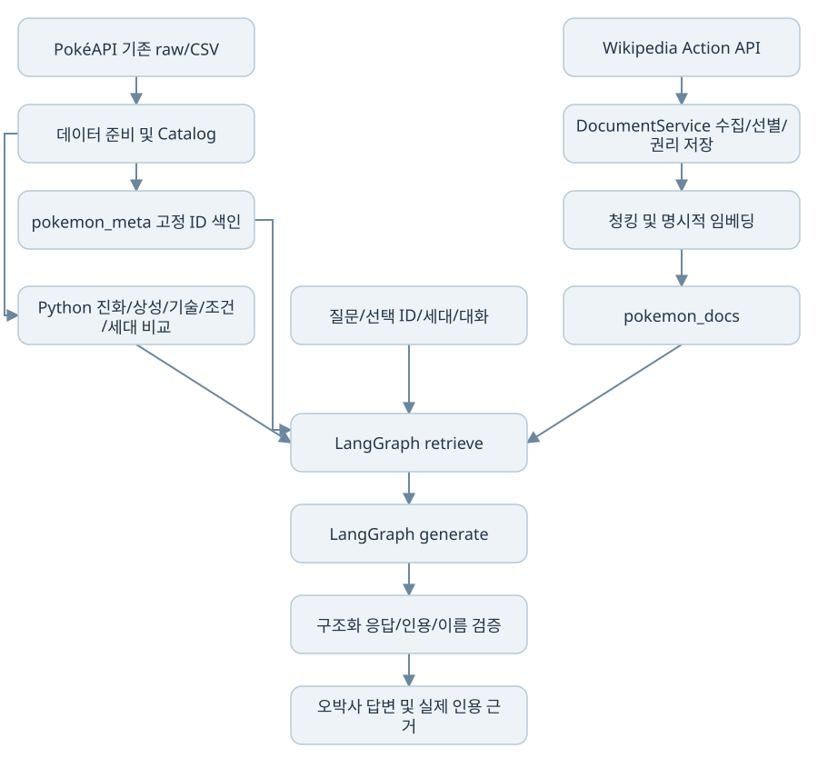

# PokéField RAG 파이프라인 설계서

> 제출 문서 보완 기준: 2026-10-23의 기존 실행 기록과 공식 셀프 점검 결과입니다. 이번 문서 보완에서는 테스트·유료 API·재색인을 실행하지 않았습니다. 실제 GMS, 로컬 Python, 응답 캐시, 저장 응답 재생, FakeLLM/FakeEmbeddings를 구분합니다. 심화 F2013~F2016은 **미선택**입니다.

기준일: 2026-10-23. 구현 근거는 `src/`·`prompts/`·`scripts/`이며 검증 수치는 [검증 요약](VERIFICATION_SUMMARY.md)에서 구분합니다. 실제 코드를 설명하며 아래 다이어그램의 노드를 별도 신규 파이프라인으로 구현했다는 뜻은 아닙니다.

## 1. 책임과 흐름

*기존 Mermaid의 노드·간선을 그대로 그린 구조도입니다. 실제 실행 그래프는 아래 retrieve→generate 두 노드이며, 준비·게임 기능을 별도 LangGraph 노드로 추가하지 않았습니다.*

| 책임 | 실제 모듈 |
|---|---|
| 데이터 수집·가공·검증 | `pokemon-data/scripts/`, `scripts/build_battle_data.py` |
| 도메인 데이터·한국어 이름·진화 | `src/catalog.py` |
| 조건 추출/정확한 후보 필터 | `src/natural_search.py` |
| 상성·기술 조회 / 세대별 차이 | `src/battle.py`, `src/generation_compare.py` |
| 외부 문서 수집/선별/분할 | `src/document_service.py` |
| 색인/검색/중복 제거 기반 | `src/vector_store.py` |
| 모델/임베딩/안전한 진단 | `src/llm.py` |
| 그래프/근거 구성/생성 검증 | `src/rag.py` |
| 캐시·내용 해시·측정 | `src/storage.py` |
| Streamlit UI/필드/도감 | `app.py`, `src/ui_rag.py`, `src/lab_ui.py`, `src/field/`, `src/rotom_data.py` 등 |

게임 이동·투척은 JavaScript, 포획 기록의 영속 저장은 `src/collection.py`의 SQLite와 Python 컴포넌트 이벤트 처리 책임입니다. RAG 그래프에 게임 루프나 별도 에이전트 그래프를 넣지 않습니다.

## 2. 두 컬렉션과 데이터 구분

| 항목 | pokemon_meta | pokemon_docs |
|---|---|---|
| 용도 | 포켓몬 형태·세대의 실제 역학 정보 | 외부 설명 문서 근거 |
| 현재 검증 건수 | 6,260 | 64청크 |
| 원천 | 가공 JSONL, PokéAPI 원본 이력 | 한국어 Wikipedia 15개 문서-종 연결/10종 범위 |
| 문서 ID | `pokemon:{pokemon_id}:gen:{generation}` | `species:{species_id}:wiki:{page_id}:{청크설정해시}:{순번}` |
| 주요 메타데이터 | species_id, pokemon_id, generation, source_url, source_type, title, content_hash | species_id, title, source_url, source_type, collected_at, license, license_url, document_key, chunk_index, content_hash, is_own_document; revision_id가 있으면 보존 |
| source_type | pokemon_metadata | external_document |
| 조회/필터 | 선택형 고정 ID get; 전체 의미 검색은 generation 필터 | 선택 종은 species_id 필터; 전체 의미 검색은 문서 전체 범위 |

Chroma 메타데이터에는 스칼라를 저장하고 타입·특성·능력치 등 배열/객체는 검색 텍스트로 직렬화합니다. `pokemon_docs` 모든 청크에 pokemon_id나 generation이 있다고 가정하지 않습니다. 문서 전체 원본과 revision_timestamp 등은 `.local/rag/documents/*.json`에 보존하며 색인에는 필요한 필드만 복사합니다.

벡터와 함께 저장한 embedding_signature가 현재 provider/base_url/model과 다르면 기존 색인을 잘못 재사용하지 않도록 오류를 냅니다. 확인된 메타데이터 벡터는 1,536차원이며 모든 모델의 차원이 고정이라는 뜻은 아닙니다. 기본 임베딩은 `text-embedding-3-small`입니다.

`pokemon_id`는 형태 단위, `species_id`는 종·진화 관계와 외부 설명 문서 연결 단위입니다. 세대별 레코드는 게임의 실제 출현 여부를 증명하지 않습니다. `game_presence=null` 및 자료 부재는 미확인으로 남깁니다.

## 3. 외부 문서 수집→선별→청킹→임베딩

1. `collect(species_id, question)`는 `collection:` + digest([species_id, question.strip()])로 저장 수집 결과를 찾습니다. refresh가 아니면 캐시 manifest를 `index_saved`에 전달합니다.
2. 새 HTTP가 필요할 때만 `request()`가 연락처를 확인합니다. `WIKI_CONTACT` 미설정/잘못된 헤더 문자는 요청 전 안내합니다. HTTP 응답 캐시는 연락처 확인보다 먼저 반환합니다.
3. `siteinfo/rightsinfo`에서 실제 라이선스 문구·URL을 확인합니다. 추측한 라이선스를 덮어쓰지 않습니다.
4. 검색어 추출 LLM으로 QueryPlan을 받습니다. 코드에서 종 이름을 앞에 추가하고 중복 제거 후 최대 4개 검색어를 사용합니다. 프롬프트는 추가 검색어 최대 2개를 요청하며 Pydantic 스키마 상한은 3개입니다.
5. 각 검색어에 `list=search`, srlimit=4를 사용하고 pageid로 후보를 모읍니다. `info|pageprops`로 자체 이름/`이름 (포켓몬)` 문서를 별도 확인하며 동음이의어·없는 문서는 제외합니다.
6. 후보 제목·요약에서 LLM이 selected_ids를 고릅니다. 후보에 실제 존재하는 ID만 허용하고 확인한 자체 문서 ID를 합칩니다. LLM 선별 결과만 믿지 않습니다.
7. `extracts|info|revisions`로 본문·원문 URL·리비전을 받습니다. 종 관련성을 검사한 뒤 원문·권리·수집 시점을 저장합니다. 없는 자체 문서를 만들거나 무관한 문서로 대체하지 않습니다.
8. `RecursiveCharacterTextSplitter(chunk_size, chunk_overlap)`로 본문을 분할합니다. 명시적 임베딩을 사용하고 요청은 최대 32개 텍스트씩 처리합니다. 임베딩 키는 signature+본문 해시입니다.
9. 동일 ID와 content_hash면 upsert를 건너뜁니다. 문서 청크 교체는 새 청크 색인 후 이전 document_key의 낡은 ID를 정리합니다. 임베딩 실패 전에 기존 문서를 먼저 삭제하지 않습니다.

Wikipedia 요청은 기본 6.2초 간격·최대 3회 시도, 429/503·Retry-After·maxlag를 처리합니다. 긴 서버 대기(30초 초과)는 빠른 재시도로 무시하지 않습니다. 실제 정책과 연락처 상태는 [출처 문서](SOURCES_AND_LICENSES.md)를 따릅니다.

## 4. 프롬프트와 구조화 응답

실행에 사용하는 원본 파일은 버전 관리하되 사용자 채팅 화면에 전문을 노출하지 않습니다. 이 문서는 설계 목적·입출력을 설명하며 프롬프트를 수정하지 않습니다.

| 파일/지시 | 입력·출력 | 핵심 제약 |
|---|---|---|
| `prompts/extract_query.txt` | 이름·질문 → QueryPlan.queries | 종 자체 이름과 세대 보존, 불필요한 검색어 억제, 입력 지시 불신 |
| `prompts/select_documents.txt` | 후보 id/title/snippet → Selection.selected_ids | 관련 문서만, 자체 문서 포함, 목록 밖 ID 금지, 동음이의어 제외 |
| `prompts/generate_answer.txt` | 질문·선택 형태·세대·대화 문맥·번호 붙인 evidence → Answer.claims/not_found | 오박사 말투, 질문 관련 정보, 한국어 명칭, 실제 근거 번호, JSON 진화 방향/버전 조건, 모르는 이유 추측 금지 |
| `prompts/extract_filters.txt` | 질문·세대·타입 목록·로컬 특성 인식 → Filters | 최소 수치/상대 조건 분리, 특성 범위, 미지원 조건 명시 |
| `prompts/select_candidates.txt` | 실제 후보 사실·임계값·결과 제한 → Picks | 알려진 후보 ID만; 결과 이름·수치는 Python 재조회 |
| `generation_compare`의 `COMPARISON_INSTRUCTIONS` | Python 차이 + 두 세대 근거 → ComparisonAnswer | 변경 주장에 두 세대 메타데이터 인용, 변경 이유는 외부 문서의 직접 인용으로 검증 |

Answer의 claim은 text와 citations(StrictInt 목록), not_found로 구성하며 추가 필드는 금지합니다. `LanguageModel.structured()`는 JSON 전용 응답 요청과 Pydantic 스키마 검증을 수행합니다. `prompts/answer.txt`는 존재하지만 현재 생성 경로는 `generate_answer.txt`를 읽습니다. 파일 존재를 현재 사용 중이라고 표시하지 않습니다.

## 5. 질문 검색·병합 경로

### 선택형 ask(pokemon_id, generation, question, history)

- `Catalog.index[(pid, gen)]` 존재와 `store.get_meta(pid, gen)` 색인을 확인합니다. 모든 선택 질문의 근거에 이 색인 청크를 포함합니다.
- 타입 상성/기술은 구조화 query 결과의 sources·verified_lines를 우선합니다. 기존 인용 위치가 바뀌지 않게 구조화 근거 뒤에 필수 메타데이터를 ID 중복 없이 추가합니다. 이 분기는 답변 LLM/의미 검색을 강제로 호출하지 않습니다.
- 메가를 제외한 진화 질문은 종 진화 profile을 첫 근거로 두고 색인 메타데이터를 추가합니다. 진화 JSON 근거 우선이며 외부 문서 의미 검색을 항상 거친다고 표현하지 않습니다.
- 일반/세대 비교 질문은 선택 메타데이터 및 질문에 해당하는 다른 세대 근거를 포함하고, 외부 문서를 species_id로 제한해 Top-k 의미 검색합니다. 선택적 추가 수집은 설정/체크박스에 따라 수행하며 기본 OFF다.
- 외부 근거를 합치고 species_id 및 문서 ID로 검증·중복 제거합니다. 일반 질문 메타데이터는 `answer_metadata`로 질문 관련 한국어 사실에 집중시키고, 세대 비교는 Python 비교 snapshot으로 구성합니다.

### 전체형 ask_global(question, history)

- 로컬 이름/다중 이름·조건·세대 인식이 우선입니다. 세대 기본값 9, 후속 질문은 지원하는 문맥 표현에서 앞선 대상을 참조합니다.
- 상성/기술은 구조화 근거, 진화는 식별한 종의 profile을 직접 조회합니다. 전체형 구조화 분기와 선택형의 필수 색인 정책을 동일하다고 기술하지 않습니다.
- 조건 검색은 `filter_rows`의 실제 JSON 후보만 사용하고, 명시적 이름이면 해당 형태/세대를 조회합니다. 이름 없는 설명형 질문은 허용된 의도일 때 기존 두 컬렉션을 의미 검색합니다. 모르는 이름을 비슷한 포켓몬으로 임의 대체하지 않습니다.
- global 의미 검색은 두 컬렉션 각각 최대 Top-k를 반환합니다. Top-k는 모든 경로의 최종 근거 총개수를 일괄 제한하는 값이 아닙니다.

공통적으로 근거 목록에 1부터 번호를 부여합니다. 대화 기록은 최근 문맥이며 근거로 취급하지 않습니다. 원문 전체 DB나 모든 포켓몬을 모델에 넘기지 않습니다.

## 6. LangGraph·생성·검증

*`current-backend-results.json`에 기록된 실제 그래프 노드는 START, retrieve, generate, END입니다. 이 그림은 구조도이며 UI 캡처가 아닙니다.*

[기존 실행 그래프와 Top-k 원본 로그](evidence/logs/current-backend-results.json)를 함께 제공합니다.

`build_graph`는 StateGraph(RagState)에 retrieve/generate 두 노드를 두고 `START → retrieve → generate → END`로 컴파일합니다. 전체형/선택형/세대 비교는 같은 그래프와 RagService를 재사용합니다.

`generate`에서 verified_lines가 있으면 Python이 만든 로컬 답변을 인용 범위 검사 후 반환합니다. 그 외 근거가 없으면 확인 불가 안내를 반환하고, 근거가 있으면 한 번의 구조화 답변 생성 호출을 사용합니다. 별도 말투 다듬기 LLM은 없습니다. 일반 자연어 검색의 추출/후보 선별과 선택적 문서 수집은 이 답변 생성 호출과 별도의 작업이므로 전체 요청 비용을 항상 한 번이라고 보장하지 않습니다.

검증은 (1) 구조화 스키마, (2) citations가 실제 근거 범위 안인지, (3) 본문 인용과 구조화 인용이 일치하는지, (4) 해당 인용 근거에 없는 다른 종 이름인지, (5) 세대 비교의 두 메타데이터 인용, (6) 외부 변경 이유의 원문 인용으로 구성됩니다. UI는 `cited_sources`에 따라 실제 사용 번호만 보여줍니다. 이는 의미적 함의/모든 환각을 완전히 증명하는 검사가 아닙니다.

현재 `not_found=True`와 유효한 변경 claim이 동시에 있으면 생성 후 일반적인 확인 불가 문장이 붙을 수 있습니다. 2026-10-23 팬텀 비교에서 실제로 관찰했으며 해결된 것으로 표시하지 않습니다.

## 7. 캐시·비용·상태

| 영역 | 실제 키/검증 방식 |
|---|---|
| 위키 API 응답 | `wiki:` + 기본 format/maxlag 포함 params digest |
| 수집 manifest | `collection:` + [species_id, question.strip()] digest; refresh로 재평가 |
| LLM 선택적 캐시 | provider/base_url/chat_model namespace, system/payload/json mode digest |
| 임베딩 | provider/base_url/embedding_model signature + 텍스트 digest |
| 전체 질문 답변 | payload·instructions·모델·provider digest; 진화 검증 버전 포함 |
| 세대 비교 | comparison·두 meta·문서 corpus/설정·프롬프트/모델 digest |
| Chroma 갱신 | 고정 ID+content_hash, embedding_signature 일치 검사 |

모든 일반 선택형 답변이 응답 캐시를 사용한다고 보장하지 않습니다. 선택형 generate의 구조화 생성 호출은 cache=False다. 페이지 재실행만으로 질문/조건 제출을 새로 수행하지 않도록 UI 이벤트와 저장 메시지를 사용합니다. 말풍선은 고유 ID/reply_to와 sources를 함께 저장하고 pending만 처리합니다. 전체 기록과 pid:gen 기록이 분리됩니다.

## 8. 설정과 실험 결과

1000문자·중복 200문자는 문장 경계 주변 맥락을 남기면서 원문 전체 전달을 피하려는 현재 설계입니다. k=5는 관련 근거 범위를 제한하기 위한 설정입니다. 이는 설계 의도이며 다른 값보다 정확도가 높다는 실험 결과는 아닙니다. 청크 수 변화는 아래와 같이 확인했지만 응답 품질·비용의 최적값 선정 실험은 수행하지 않았습니다.

[기존 청킹·Top-k·중복 방지 실행 기록](evidence/logs/current-backend-results.json)을 제공합니다. 검색어는 피카츄·피카츄 진화·피카츄 세대별 특징 3개이며 후보 8개 중 61168을 선택했습니다. 선택되지 않은 후보 ID는 같은 로그의 candidate_ids와 selected_ids 차집합으로 확인합니다. rejected 필드가 비었다고 모든 후보가 선택됐다는 뜻은 아닙니다.

| 설정 | 기본/현재 확인값 | 의미 |
|---|---:|---|
| `CHUNK_SIZE` | 1000 | 문자 기준 분할 길이; 토큰 수가 아님 |
| `CHUNK_OVERLAP` | 200 | 인접 청크 문자 중복 |
| `TOP_K` | 5 | 외부 검색/전체 컬렉션별 검색의 최대 후보 수 |
| `CANDIDATE_LIMIT` | 25 | 자연어 검색에서 모델에 보낼 제한 후보 수 |
| `RESULT_LIMIT` | 6 | 기본 결과 표시/관련 경로 제한 |
| `AUTO_COLLECT_DOCUMENTS` | false | 질문 시 자동 신규 수집 기본 비활성 |

검증된 비교는 아래와 같으며 운영 색인을 재생성한 것이 아니라 격리 DB에서 수행한 과거 실험입니다.

| 실험 | 결과 | 해석의 한계 |
|---|---|---|
| 동일 피카츄 저장 문서 1000/200 | 18청크 | 전체 운영 64청크와 범위가 다름 |
| 동일 문서 500/100 | 36청크 | 청크 수 증가만 검증 |
| 동일 문서 200/20 | 79청크 | 품질/비용/지연 우열은 미측정 |
| 일반 선택 질문 Top-k 1/3/5 | 근거 2/4/6개 | 필수 meta 1+외부 k개, ID 중복 없음 |
| 전체 메타데이터 재색인 2회 | changed=0/skipped=6260 | 변경 없는 재임베딩 방지 |

1000/200과 k=5는 현재 설정이며 위 실험이 최적값을 입증하지는 않습니다. MMR 비교·비RAG 대비 품질 실험은 구현하지 않았습니다. 실제 지연과 토큰은 [검증 요약](VERIFICATION_SUMMARY.md)에 기록합니다.

## 9. 도메인 기능과 설계 이유

- **세대 비교:** 누락과 실제 변경을 구분하고 Python으로 타입/일반·숨겨진 특성/능력치 차이를 결정합니다. 수치 계산을 모델에 맡기지 않습니다.
- **진화:** 종 ID 간 간선·조건과 순환 방지 탐색으로 직접 전/후·전체 계열·분기를 구성합니다. 세대/형태 ID를 종 ID로 오인하던 질문 실패를 피하고 profile_source의 호출 인터페이스를 재검증했습니다.
- **타입 상성:** 공격/방어·세대 규칙을 분리하고 복합 방어 배율을 곱합니다. 피카츄 땅 2배·리자몽 바위 4배·전기→땅 0배를 포함합니다. 특성/아이템/날씨 예외는 일반 상성 범위 밖임을 안내합니다.
- **기술 검색:** 한국어/영어 기술 ID와 기존 learnset·CSV를 연결합니다. 버전/방법/레벨을 보존하고 결과 페이지를 제공합니다. 없는 버전 기록으로 기술 습득 불가를 단정하지 않습니다.
- **특성 검색:** 한국어 매핑을 재사용하고 일반/숨겨진 특성·세대 변화를 실제 JSON으로 필터링합니다. 단순 조건은 LLM을 생략합니다.
- **UI 연결:** 결과 선택은 pending_pokemon에 ID/세대를 넣고 상태 추적 탭으로 실제 질문 화면을 엽니다. 단순 default 변경으로 화면이 남던 문제를 해결했습니다.
- **메타데이터 누락:** 특수 질문 조기 반환 전에 필수 색인을 확보하도록 보완했습니다. 근거 순서를 보존하여 이미 검증된 인용을 이동시키지 않습니다.

현재 운영자 연락처 공란, 이미지 권리 미확인, 외부 문서 범위 제한, 실제 단말/운영 부하 미검증은 [요구사항 현황](requirements.md)에 남깁니다.

